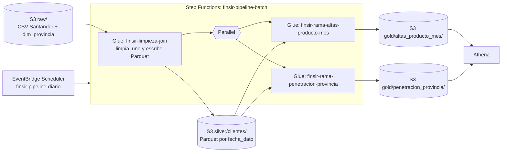
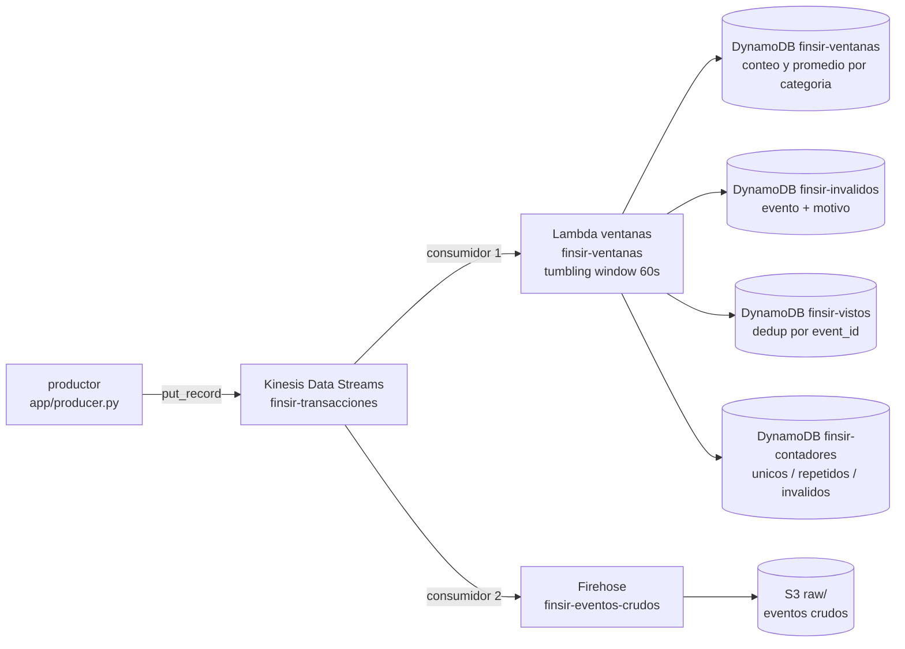

# Informe del Trabajo 2: procesamiento de datos en AWS

Este informe reúne la descripción y las instrucciones de despliegue de las partes A y B del trabajo práctico de Big Data del proyecto FINSIR. Incluye la creación manual desde la consola de AWS y la alternativa automatizada con Terraform, además de la ejecución, consulta de resultados y eliminación de recursos que documenta cada parte.

Sigue los pasos de la parte que vayas a desplegar y ten en cuenta el directorio indicado en cada guía cuando ejecutes comandos relativos. Las guías originales y los archivos de código permanecen en sus respectivas carpetas.

## Contenido

- [Parte A: pipeline batch](#parte-a-pipeline-batch-con-glue-step-functions-y-eventbridge-scheduler)
  - [Descripción, datos y transformaciones](#qué-construye-este-pipeline)
  - [Despliegue manual y Terraform](#opción-1-a-mano-desde-la-consola)
  - [Consultas en Athena y eliminación](#consultar-los-resultados-en-athena)
- [Parte B: streaming](#parte-b-streaming-con-kinesis-lambda-dynamodb-y-s3)
  - [Arquitectura y evento](#1-qué-hace-en-una-frase)
  - [Creación manual desde la consola](#5-creación-manual-desde-la-consola)
  - [Terraform, ejecución y limpieza](#6-despliegue-automatizado-con-terraform)

---

# Parte A: pipeline batch con Glue, Step Functions y EventBridge Scheduler

Los archivos y comandos de esta parte se encuentran bajo `parte_a/`. Cuando la guía indique ejecutar comandos desde `parte_a/`, cambia a ese directorio antes de correrlos.

## Qué construye este pipeline

El pipeline procesa los datos de [Santander Product Recommendation](https://www.kaggle.com/c/santander-product-recommendation) (del proyecto FINSIR, un recomendador de productos financieros) y responde dos preguntas de negocio.



Cada pieza cumple un rol:

| Pieza                               | Qué hace                                                                                                                               |
| ----------------------------------- | -------------------------------------------------------------------------------------------------------------------------------------- |
| EventBridge Scheduler               | Un horario arranca el pipeline, como lo haría un proceso diario real                                                                   |
| `finsir-limpieza-join`              | Lee el CSV crudo, lo limpia, lo une con las provincias y guarda el resultado en Parquet                                                |
| `finsir-rama-altas-producto-mes`    | **Pregunta 1:** ¿cuántas contrataciones nuevas tiene cada producto cada mes y cuáles se contratan más?                                 |
| `finsir-rama-penetracion-provincia` | **Pregunta 2:** ¿en qué provincias el banco tiene pocos clientes para su población, y cuántos le faltan? Sirve para priorizar campañas |
| Athena                              | Consulta los resultados y responde las dos preguntas                                                                                   |

Las tres capas de datos siguen el patrón clásico: **raw** (datos crudos), **silver** (datos limpios) y **gold** (resultados listos para consultar).

---

## Los datos

| Conjunto                                                                        | Archivo                                                 | Registros      | Columna en común |
| ------------------------------------------------------------------------------- | ------------------------------------------------------- | -------------- | ---------------- |
| Clientes y productos de Santander, 17 cortes mensuales (enero 2015 a mayo 2016) | `train_ver2.csv`, 2.3 GB, 48 columnas                   | **13 647 309** | `cod_prov`       |
| Provincias de España: comunidad, población (2016) y renta (2015), del INE       | [dim_provincia.csv](parte_a/data/dim_provincia.csv), 2.3 KB, 6 columnas | 52             | `cod_prov`       |

El primer conjunto tiene 13.6 millones de registros, por encima del mínimo de 5 millones. El segundo son datos oficiales del Instituto Nacional de Estadística (INE), que se pueden reutilizar citando la fuente. Se descargaron de su API (`servicios.ine.es/wstempus`):

- **Población:** tabla 2852, padrón al 1 de enero de 2016. Las 52 provincias suman 46 557 008, igual que el total nacional.
- **Renta:** tabla 53689, Atlas de renta de los hogares (2015). El INE no publica la renta de 2015 de Álava, Gipuzkoa y Navarra (régimen foral), así que esas tres quedan vacías.
- **Comunidad autónoma:** la que corresponde a cada provincia.

El CSV de Santander **no está en el repositorio**: las reglas de Kaggle no permiten redistribuirlo. Descárgalo tú de [Kaggle: Santander Product Recommendation](https://www.kaggle.com/competitions/santander-product-recommendation/data?select=train_ver2.csv.zip), descomprímelo y déjalo en `data/train_ver2.csv`.

---

## Qué hace el pipeline con los datos

Tres decisiones de diseño que vale la pena conocer:

**Limpieza.** El trabajo inicial corrige los datos con reglas defendibles, sin inventar valores:

- Descarta 27 734 filas sin `fecha_alta` (solo traen productos, ni edad ni sexo).
- Cuando el segmento o la provincia vienen vacíos en un mes, los toma del mismo cliente en otro mes.
- Corrige 22 edades imposibles (126, 127, 163 y 164 años) con la mediana de su segmento. Las de 100 a 117 son clientes reales y se conservan.
- Imputa 2 766 641 rentas vacías con la mediana de su provincia y segmento.
- Lo que sigue vacío queda como `DESCONOCIDO` en los textos y `0` en nómina y pensión.
- Quita cuatro columnas inútiles: `ult_fec_cli_1t`, `conyuemp` (casi todo vacío), `tipodom` (siempre 1) y `nomprov` (la reemplaza la provincia de la dimensión).

**Join.** Un _left join_ con `dim_provincia` por `cod_prov`. Se usa left join para no perder los 65 171 clientes que nunca traen provincia (quedan con comunidad `DESCONOCIDA`). Cada cliente recibe la población y la renta de su provincia.

**Partición.** El Parquet se particiona por `fecha_dato` (el mes del corte): 17 particiones de 620 000 a 930 000 filas cada una. Así, cuando una consulta filtra por mes, Athena lee solo esa carpeta en vez del archivo entero.

---

## Antes de empezar

- Una cuenta de AWS, región **N. Virginia (`us-east-1`)**. Trabaja siempre en esa región (revísala arriba a la derecha).
- El archivo `train_ver2.csv` descargado de Kaggle y descomprimido en `data/`.
- El AWS CLI configurado con tus credenciales (solo para subir el CSV).
- La consola de **CloudFormation** sin stacks en la región (borra los de laboratorios anteriores si quedan). Nada de esta guía crea stacks.

**Costo.** Una ejecución completa del pipeline cuesta del orden de un dólar (Glue cobra por DPU-hora). S3, Step Functions, Scheduler y Athena cuestan centavos. No dejes horarios recurrentes activos.

---

## Opción 1: a mano desde la consola

Sigue el formato de los laboratorios [9](https://github.com/si7006eafit/si7006-262/tree/main/labs/09-glue-batch) y [9b](https://github.com/si7006eafit/si7006-262/tree/main/labs/09b-s3-glue-athena), con los datos de Santander.

### Paso 1: El bucket y los datos crudos

1. En **S3**, **Create bucket**. Tipo **General purpose**, nombre `finsir-trabajo2-<ID_CUENTA>` (tu ID de cuenta son 12 dígitos, está arriba a la derecha). Deja **Block all public access** y el cifrado por defecto. **Create bucket**.
2. Dentro del bucket crea la carpeta `raw`, y dentro de ella `santander` y `dim_provincia`.
3. Sube `train_ver2.csv` a `raw/santander/`. Son 2.1 GiB: tarda según tu conexión. Esa carpeta debe tener **solo** ese archivo, porque Glue lee la carpeta completa.
4. Sube [data/dim_provincia.csv](parte_a/data/dim_provincia.csv) a `raw/dim_provincia/`.

Más rápido por línea de comandos, parado en `parte_a/`:

```bash
aws s3 cp data/train_ver2.csv s3://finsir-trabajo2-<ID_CUENTA>/raw/santander/train_ver2.csv
```

Esperado: `raw/santander/train_ver2.csv` de 2 292 759 599 bytes y `raw/dim_provincia/dim_provincia.csv` de 2324 bytes.

### Paso 2: El rol de Glue

1. En **IAM**, **Roles**, **Create role**. **Trusted entity type**: **AWS service**. En **Use case** elige **Glue**. **Next**.
2. Marca la política **AWSGlueServiceRole**. **Next**.
3. Nombre: `finsir-glue-role`. **Create role**.
4. Abre el rol, **Add permissions**, **Create inline policy**, pestaña **JSON**. Pega [iam/glue-bucket-policy.json](parte_a/iam/glue-bucket-policy.json) y reemplaza `YOUR_BUCKET` (dos veces) por tu bucket. Nombre `finsir-acceso-al-bucket`, **Create policy**.

Esperado: el rol tiene dos políticas, `AWSGlueServiceRole` y `finsir-acceso-al-bucket`.

### Paso 3: El trabajo de Glue inicial

1. En **AWS Glue**, **ETL jobs**, **Create job**, **Script editor**. Motor **Spark**, **Upload script**, elige [glue/01_limpieza_join.py](parte_a/glue/01_limpieza_join.py). **Create script**.
2. Cambia el nombre `Untitled job` por `finsir-limpieza-join`.
3. En **Job details**:

    | Campo                       | Valor              |
    | --------------------------- | ------------------ |
    | IAM Role                    | `finsir-glue-role` |
    | Glue version                | Glue 6.0           |
    | Worker type                 | G 1X               |
    | Requested number of workers | 5                  |
    | Job bookmark                | Disable            |
    | Number of retries           | 0                  |
    | Job timeout (minutes)       | 60                 |

    En **Advanced properties** → **Job parameters**, **Add new parameter**: clave `--BUCKET`, valor tu bucket.

4. **Save** y **Run**.
5. En **Runs**, espera a **Succeeded** (5 a 15 minutos). Abre **Output logs** (CloudWatch) para ver el detalle.

Esperado en el log (líneas `[finsir]`):

```text
[finsir] filas leidas:                    13647309
[finsir] descartadas (sin fecha_alta):    27734
[finsir] edades corregidas (fuera 0-122): 22
[finsir] rentas imputadas:                2766641
[finsir] filas escritas en s3://.../silver/clientes/: 13619575
```

Esperado en S3: `silver/clientes/` con 17 carpetas, de `fecha_dato=2015-01-28/` a `fecha_dato=2016-05-28/`.

### Paso 4: Los trabajos de las dos ramas

Repite el paso 3 dos veces más (**Create job**, **Script editor**, **Upload script**):

| Nombre del trabajo                  | Script                                                                         | Workers |
| ----------------------------------- | ------------------------------------------------------------------------------ | ------- |
| `finsir-rama-altas-producto-mes`    | [glue/02_rama_altas_producto_mes.py](parte_a/glue/02_rama_altas_producto_mes.py)       | 4       |
| `finsir-rama-penetracion-provincia` | [glue/03_rama_penetracion_provincia.py](parte_a/glue/03_rama_penetracion_provincia.py) | 4       |

Todo lo demás igual que el paso 3. Los nombres deben ser exactos, porque la máquina de estados los busca por nombre. Ejecuta cada uno con **Run** para comprobar que funcionan.

Esperado: `[finsir] filas escritas en .../gold/altas_producto_mes/: 408` (17 meses × 24 productos) y `[finsir] corte 2016-05-28: 53 filas en .../gold/penetracion_provincia/`.

### Paso 5: La máquina de estados

1. En **Step Functions**, **Create state machine**, plantilla **Blank**.
2. En la pestaña **Code**, borra todo y pega [stepfunctions/state_machine.asl.json](parte_a/stepfunctions/state_machine.asl.json). En **Design** verás `LimpiezaJoin` seguido de las dos ramas en paralelo. **Next**.
3. Nombre `finsir-pipeline-batch`, tipo **Standard**. En **Permissions** deja **Create new role**. **Create state machine**.
4. Pruébala: **Start execution**, entrada `{}`, **Start execution**. `LimpiezaJoin` se pone verde primero, y solo después arrancan las dos ramas a la vez.

Esperado: termina en **Succeeded** en 15 a 30 minutos. No corras dos pipelines a la vez ni lances un trabajo de Glue a mano mientras corre (cada trabajo admite una sola ejecución).

### Paso 6: El horario de EventBridge Scheduler

El horario es recurrente (como uno real), pero con fecha de fin para que se dispare una sola vez y no gaste créditos a diario.

1. En **Amazon EventBridge**, **Scheduler**, **Schedules**, **Create schedule**.
2. **Schedule detail**:
    - Nombre `finsir-pipeline-diario`.
    - **Recurring schedule**, zona horaria la tuya (ej. `America/Bogota`), **Cron-based schedule**.
    - Una hora **unos 10 minutos en el futuro**. Ejemplo 15:30: `cron(30 15 * * ? *)`.
    - **Flexible time window**: **Off**.
    - **End date and time**: activa y pon **1 hora después** del disparo (misma fecha).
3. **Select target**: **Templated targets**, **AWS Step Functions StartExecution**, máquina `finsir-pipeline-batch`. En **Input**:

    ```json
    { "origen": "EventBridge Scheduler", "horario": "finsir-pipeline-diario" }
    ```

4. **Settings**: **Enable**, **Create new role for this schedule**. **Create schedule**.
5. A la hora del disparo, en **Step Functions** → `finsir-pipeline-batch` → **Executions** aparece una ejecución nueva con ese JSON de entrada.

Cuando termine, **desactiva** o borra el horario para no pagar ejecuciones futuras.

---

## Opción 2: automático con Terraform

Terraform crea todo de una vez: el bucket (con los scripts y la dimensión ya subidos), los roles, los tres trabajos de Glue, la máquina de estados, el horario (**desactivado**) y las tablas de Athena. Con Terraform la tabla silver usa _partition projection_, así que no necesitas `MSCK REPAIR TABLE`.

Necesitas **Terraform 1.5+** y credenciales de AWS en el entorno. El código está en [terraform/](parte_a/terraform/).

```bash
cd terraform
cp terraform.tfvars.example terraform.tfvars   # opcional, para ajustar región u horario
terraform init
terraform apply
```

> Si el `apply` falla porque falta un servicio en el plan de la cuenta, actualiza el plan y vuelve a correr `terraform apply`.

Después del `apply`, sube el CSV (Terraform no lo sube, pesa 2.3 GB) e inicia el pipeline. Parado en `parte_a/`:

```bash
# Sube el CSV (el comando exacto con tu bucket sale en el output subir_el_csv)
aws s3 cp data/train_ver2.csv s3://finsir-trabajo2-<ID_CUENTA>/raw/santander/train_ver2.csv

# Inicia el pipeline (el ARN exacto sale en el output iniciar_la_maquina_de_estados)
aws stepfunctions start-execution --state-machine-arn <ARN_DE_LA_MAQUINA>
```

O activa el horario con `schedule_enabled = true` en `terraform.tfvars`.

Variables que puedes ajustar (en `terraform.tfvars`):

| Variable                             | Default     | Para qué                                                |
| ------------------------------------ | ----------- | ------------------------------------------------------- |
| `region`                             | `us-east-1` | región                                                  |
| `project`                            | `finsir`    | prefijo de los nombres                                  |
| `bucket_name`                        | `""`        | si lo dejas vacío usa `finsir-trabajo2-<cuenta>`        |
| `workers_limpieza` / `workers_ramas` | 5 / 4       | baja estos si da `ResourceNumberLimitExceeded`          |
| `schedule_enabled`                   | `false`     | ponlo en `true` para que el horario dispare el pipeline |

---

## Consultar los resultados en Athena

1. En **Athena**, **Query editor**, **Settings** → **Manage**, pon **Location of query result** en `s3://<tu bucket>/athena-results/`. **Save**. (Con Terraform esto ya queda listo.)
2. Si lo hiciste a mano: copia [athena/01_tablas.sql](parte_a/athena/01_tablas.sql), reemplaza `YOUR_BUCKET` y ejecuta **una sentencia a la vez**. La sentencia 5 (`MSCK REPAIR TABLE`) registra las 17 particiones. Con Terraform las tablas ya existen, salta este punto.
3. Copia [athena/02_consultas.sql](parte_a/athena/02_consultas.sql) y ejecuta una sentencia a la vez.

Valores esperados de las consultas principales:

| Sentencia | Esperado                                                                                                                                           |
| --------- | -------------------------------------------------------------------------------------------------------------------------------------------------- |
| 1         | 13 647 309 filas y 17 meses en el CSV                                                                                                              |
| 3         | 13 619 575 filas y 949 614 clientes distintos en silver                                                                                            |
| 5         | 408 filas (24 productos × 17 meses) en la primera agrupación                                                                                       |
| 6         | Más altas: Débito automático 153 023, Pensión 84 682, Nómina ingreso 73 729, Tarjeta de crédito 69 107, Cuenta corriente 68 974                    |
| 8         | 53 filas y 931 453 clientes en la segunda agrupación                                                                                               |
| 9         | Provincias con más clientes faltantes: Santa Cruz de Tenerife (10 951), Illes Balears (8 574), Alicante (7 180), Almería (6 954), Gipuzkoa (6 601) |
| 13 y 14   | 925 076 clientes de marzo de 2016, leyendo el CSV entero (13) o una sola partición (14): compara el **Data scanned**                               |

**Respuesta a la pregunta 1.** Las contrataciones nuevas se concentran en el débito automático, la pensión y la nómina, seguidos de la tarjeta de crédito. Son los productos que un recomendador por popularidad sugeriría a todos, la referencia que debe superar el modelo del proyecto.

**Respuesta a la pregunta 2.** El banco está muy concentrado en Madrid (46 clientes por mil habitantes) y poco presente, para su población, en Canarias, Baleares, el Mediterráneo (Alicante, Almería, Girona, Tarragona), Jaén y el País Vasco. Baleares, Bizkaia, Girona y Tarragona combinan brecha alta y renta alta: son las candidatas para una campaña de captación.

### Probar los scripts en local

Los scripts de Glue se pueden probar sin AWS, con Spark local:

```bash
pip install pyspark pytest
python -m pytest glue
```

---

## Borrar todo al terminar

**Con Terraform.** Con `force_destroy_bucket = true` (el valor por defecto) el bucket se vacía solo. Si lo pusiste en `false`, o el `destroy` falla con `BucketNotEmpty`, vacía el bucket primero y vuelve a correr `destroy`:

```bash
cd terraform

# Vacía el bucket (incluye los resultados de Athena y lo que generó Glue)
aws s3 rm "s3://$(terraform output -raw bucket)" --recursive

terraform destroy
```

> El nombre exacto del bucket sale de `terraform output bucket`.

**A mano**, en este orden:

1. **EventBridge Scheduler:** el horario `finsir-pipeline-diario`.
2. **Step Functions:** la máquina `finsir-pipeline-batch`.
3. **Glue:** los tres trabajos `finsir-*`.
4. **Athena:** `DROP TABLE` de las cinco tablas y `DROP DATABASE finsir`. Las tablas son externas: no borran datos.
5. **S3:** vacía y borra `finsir-trabajo2-<ID_CUENTA>` y el bucket `aws-glue-assets-<ID_CUENTA>-us-east-1` que creó Glue Studio.
6. **IAM:** los roles `finsir-glue-role` y los que crearon Step Functions y EventBridge Scheduler.
7. **CloudWatch Logs:** los grupos `/aws-glue/jobs/output` y `/aws-glue/jobs/error`.

---

## Problemas frecuentes

| Síntoma                                                               | Causa y solución                                                                                                                               |
| --------------------------------------------------------------------- | ---------------------------------------------------------------------------------------------------------------------------------------------- |
| Glue falla con `Access Denied` en S3                                  | Al rol le falta la política `finsir-acceso-al-bucket`, o `YOUR_BUCKET` quedó sin reemplazar. Revisa el paso 2                                  |
| `Path does not exist: s3://.../raw/santander/`                        | El parámetro `--BUCKET` está vacío o mal escrito, o el CSV no está en `raw/santander/`                                                         |
| Glue termina en `OutOfMemoryError` o `Container killed`               | Sube los workers a 10, o el tipo a G 2X                                                                                                        |
| `ResourceNumberLimitExceeded` al iniciar el trabajo                   | La cuenta tiene un límite bajo de DPU. Baja los workers a 2 o 3, o pide aumentar **Max concurrent DPUs** en Service Quotas                     |
| `Glue.ConcurrentRunsExceededException`                                | Otra ejecución del mismo trabajo sigue en curso. Espera a que termine                                                                          |
| `AccessDeniedException ... glue:StartJobRun` en la máquina de estados | Al rol de Step Functions le faltan permisos. Pega [iam/stepfunctions-glue-policy.json](parte_a/iam/stepfunctions-glue-policy.json) con tu ID de cuenta |
| El horario no inicia nada                                             | Revisa la zona horaria, que la hora esté en el futuro y que el estado sea **Enabled**                                                          |
| Athena: `No output location provided`                                 | Falta configurar la carpeta de resultados (primer punto de la sección de Athena)                                                               |
| Athena: `silver_clientes` devuelve 0 filas                            | No corriste `MSCK REPAIR TABLE`, o el trabajo inicial no terminó                                                                               |
| Athena: `HIVE_BAD_DATA ... Parquet`                                   | El esquema de la tabla no coincide con el Parquet. Borra la tabla y créala de nuevo                                                            |
---

# Parte B: streaming con Kinesis, Lambda, DynamoDB y S3

Los archivos y comandos de esta parte se encuentran bajo `parte_b/`. La guía de ejecución indica cuándo correr comandos desde ese directorio.

Flujo de streaming del proyecto FINSIR, desplegado con Terraform. Sirve para **levantar la parte B rápido en la sustentación**: para la entrega los recursos se crean a mano en la consola, y esta IaC los reproduce idénticos en otra cuenta para la sustentación.

---

## 1. Qué hace, en una frase

Un productor publica movimientos financieros (cada uno con una **categoría** y un **monto**) a un stream de Kinesis. Dos consumidores leen ese stream: una **Lambda** cuenta y promedia por categoría cada minuto y lo guarda en DynamoDB, y un **Firehose** guarda todos los eventos crudos en S3.



## 2. El evento

```json
{ "event_id": "uuid", "client_id": 123, "category": "nomina", "amount": 1234.56, "ts": "2026-11-06T15:30:00Z" }
```

- **`category`**: el tipo de producto (`nomina`, `tarjeta_credito`, `cuenta_corriente`, `pension`, `deposito`, `hipoteca`). Es la _categoría_ del enunciado.
- **`amount`**: el monto del movimiento. Es el _campo numérico_ del que se saca el promedio.
- **`event_id`**: identifica el evento. Dos eventos con el mismo `event_id` son repetidos.
- Un evento es **inválido** si le falta la categoría, el monto no es numérico, o el monto queda fuera de `[0, 50000]`.

## 3. Qué guarda cada cosa

| Recurso                              | Qué guarda / hace                                                                            |
| ------------------------------------ | -------------------------------------------------------------------------------------------- |
| **Kinesis `finsir-transacciones`**   | El stream: el tubo ordenado por donde pasan todos los eventos                                |
| **Lambda `finsir-ventanas`**         | La aplicación de ventanas. Cada minuto cuenta los eventos y promedia el monto, por categoría |
| **DynamoDB `finsir-ventanas`**       | Un ítem por (minuto, categoría) con `event_count`, `avg_amount` y `sum_amount`               |
| **DynamoDB `finsir-vistos`**         | Los `event_id` ya procesados, para no contar un repetido dos veces                           |
| **DynamoDB `finsir-invalidos`**      | Cada evento inválido con el campo `reason` (el motivo del descarte)                          |
| **DynamoDB `finsir-contadores`**     | Tres contadores: `unique_processed`, `duplicates_discarded`, `invalid_discarded`             |
| **Firehose `finsir-eventos-crudos`** | El segundo consumidor: vuelca el stream a S3 sin tocar los eventos                           |
| **S3 `finsir-parte-b-<cuenta>`**     | Los eventos crudos, en `raw/dt=YYYY-MM-DD/`, comprimidos en GZIP                             |

## 4. Cómo cada punto del enunciado queda cubierto

| Punto (sección 4 del PDF)                                                                | Dónde                                                                                  |
| ---------------------------------------------------------------------------------------- | -------------------------------------------------------------------------------------- |
| 1. Productor continuo ≥ 5 min, con repetidos e inválidos a propósito                     | [app/producer.py](parte_b/app/producer.py)                                                     |
| 2. Ventanas de 1 min: conteo y promedio por categoría; repetidos no se cuentan dos veces | Lambda `finsir-ventanas` + tabla `finsir-vistos`                                       |
| 3. Inválidos apartados con su motivo                                                     | tabla `finsir-invalidos` (campo `reason`)                                              |
| 4. Resultado de cada ventana en DynamoDB + consulta que responde una pregunta            | tabla `finsir-ventanas` + [app/query_results.py](parte_b/app/query_results.py)                 |
| 5. Segundo consumidor que guarda los crudos en S3                                        | Firehose `finsir-eventos-crudos` → bucket S3                                           |
| 6. Conteos que cuadran                                                                   | tabla `finsir-contadores` + `producer_summary.json`, comparados por `query_results.py` |

**Por qué Lambda (y no Flink).** El enunciado sugiere Flink pero permite Lambda. Elegimos Lambda por **conocimiento previo del servicio y facilidad de implementación para el equipo**.

## 5. Creación manual desde la consola de AWS

Esta parte se hace en la consola gráfica. La idea es crear primero las piezas que Lambda necesita y, al final, conectar los consumidores al stream. Haz todo en una misma región; los nombres de abajo corresponden al prefijo `finsir` y a `us-east-1`.

### 5.1 Crea las tablas de DynamoDB

En DynamoDB, elige **Create table**. Para cada tabla deja la capacidad en **On-demand** (también puede aparecer como **Pay-per-request**). No necesitas índices secundarios.

| Nombre de la tabla | Partition key | Sort key | Para qué la usa el código |
|---|---|---|---|
| `finsir-ventanas` | `window_start` (String) | `category` (String) | Guarda conteo, promedio y suma por ventana y categoría |
| `finsir-vistos` | `event_id` (String) | — | Recuerda qué IDs válidos ya se contaron |
| `finsir-invalidos` | `event_id` (String) | — | Guarda los inválidos junto con el motivo |
| `finsir-contadores` | `counter` (String) | — | Acumula únicos, repetidos e inválidos |

La clave debe llamarse exactamente así y ser tipo String; Lambda usa esos nombres al escribir. En `finsir-vistos` y `finsir-invalidos`, abre la configuración de la tabla y activa **Time to Live (TTL)** con el atributo `expires_at`. Esto permite que DynamoDB elimine los registros antiguos después del periodo definido por el código. Espera a que las cuatro tablas estén `Active`.

### 5.2 Crea el bucket S3

En S3, crea un bucket en la misma región. Los nombres de bucket son globales, así que `finsir-parte-b-<id-de-cuenta>` puede estar ocupado; si pasa eso, agrega un sufijo y anota el nombre, porque Firehose tendrá que apuntar a ese mismo bucket.

Deja habilitado **Block all public access** y el cifrado predeterminado con claves administradas por S3 (SSE-S3). No hace falta crear la carpeta `raw`: Firehose la crea al escribir el primer objeto.

### 5.3 Crea el stream de Kinesis

En **Kinesis Data Streams**, elige **Create data stream**. Llámalo `finsir-transacciones`, selecciona capacidad **Provisioned** y configura **1 shard**. Si la consola permite ajustar la retención en esta pantalla, usa **24 horas**. Crea el stream y espera a que el estado cambie a `Active`.

El productor enviará los registros a este stream; Lambda y Firehose lo leerán como dos consumidores independientes.

### 5.4 Crea el rol que usará la función Lambda

El rol de ejecución es la identidad que Lambda usa mientras corre el código. No es tu usuario de la consola: tu usuario también debe tener permiso para crear la función y asignarle un rol.

En **IAM → Roles → Create role**:

1. En **Trusted entity type**, selecciona **AWS service**.
2. En **Use case**, selecciona **Lambda** y continúa. IAM configura así la relación de confianza para que `lambda.amazonaws.com` pueda asumir el rol.
3. Puedes adjuntar `AWSLambdaBasicExecutionRole` para que la función escriba logs en CloudWatch Logs. Esta política administrada es cómoda para el laboratorio, aunque sus permisos de logs son más amplios que un único grupo.
4. Nombra el rol, por ejemplo `finsir-lambda-ventanas-role`, y créalo.
5. Abre el rol que acabas de crear. En **Add permissions → Create inline policy**, selecciona la pestaña **JSON** y agrega permisos para Kinesis y las cuatro tablas.

Antes de guardar la política, reemplaza `ID_DE_CUENTA` por el número de cuenta de AWS y cambia `us-east-1` si elegiste otra región:

```json
{
  "Version": "2012-10-17",
  "Statement": [
    {
      "Sid": "ReadFinsirStream",
      "Effect": "Allow",
      "Action": [
        "kinesis:GetRecords",
        "kinesis:GetShardIterator",
        "kinesis:DescribeStream",
        "kinesis:DescribeStreamSummary",
        "kinesis:ListShards"
      ],
      "Resource": "arn:aws:kinesis:us-east-1:ID_DE_CUENTA:stream/finsir-transacciones"
    },
    {
      "Sid": "ListStreamsForConsole",
      "Effect": "Allow",
      "Action": "kinesis:ListStreams",
      "Resource": "*"
    },
    {
      "Sid": "AccessFinsirTables",
      "Effect": "Allow",
      "Action": [
        "dynamodb:PutItem",
        "dynamodb:UpdateItem",
        "dynamodb:GetItem"
      ],
      "Resource": [
        "arn:aws:dynamodb:us-east-1:ID_DE_CUENTA:table/finsir-ventanas",
        "arn:aws:dynamodb:us-east-1:ID_DE_CUENTA:table/finsir-vistos",
        "arn:aws:dynamodb:us-east-1:ID_DE_CUENTA:table/finsir-invalidos",
        "arn:aws:dynamodb:us-east-1:ID_DE_CUENTA:table/finsir-contadores"
      ]
    }
  ]
}
```

Ponle un nombre a la política, por ejemplo `finsir-lambda-stream-tables`, y guárdala. `ListStreams` aparece con `Resource: "*"` porque esa acción lista los streams de la cuenta y no se restringe a un ARN particular. Las otras acciones de lectura están limitadas al stream del proyecto; los permisos DynamoDB, a las cuatro tablas.

Si decidiste **no** adjuntar `AWSLambdaBasicExecutionRole` y quieres restringir también los logs, crea en CloudWatch Logs el grupo `/aws/lambda/finsir-ventanas` y agrega a la política acciones `logs:CreateLogStream` y `logs:PutLogEvents`, limitadas al ARN de ese grupo. Si sí adjuntaste la política básica, no necesitas duplicar esos permisos en la inline.

Cuando agregues el trigger de Kinesis más adelante, si no aparece `finsir-transacciones` en el selector, revisa los permisos de la identidad con la que iniciaste sesión. `kinesis:ListStreams` en el rol de ejecución da permisos a la función; no sustituye los permisos de tu usuario para configurar el trigger. Tu usuario también debe poder pasarle el rol a Lambda (`iam:PassRole`).

### 5.5 Empaqueta el código y crea la Lambda

La función que procesa cada ventana está en `app/windowing/handler.py`. Lambda recibirá un ZIP y buscará un módulo llamado `handler`; por eso `handler.py` tiene que estar directamente en la raíz del ZIP, no dentro de `app/windowing/`.

Abre PowerShell en la carpeta principal del repositorio, donde está `parte_b`. Este bloque crea el ZIP en `parte_b\finsir-windowing.zip`, así después lo encuentras fácilmente en el selector de archivos de la consola:

```powershell
$zipPath = Join-Path (Get-Location) "parte_b\finsir-windowing.zip"
Push-Location .\parte_b\app\windowing
try {
    Compress-Archive -LiteralPath .\handler.py -DestinationPath $zipPath -Force
}
finally {
    Pop-Location
}
```

`Push-Location` entra en la carpeta que contiene `handler.py`. `Compress-Archive` incluye ese archivo en el ZIP y `Pop-Location` te devuelve a la carpeta del proyecto, incluso si el empaquetado muestra un error. Comprueba el contenido del ZIP con:

```powershell
python -c "import zipfile; print(zipfile.ZipFile(r'parte_b\finsir-windowing.zip').namelist())"
```

El resultado esperado es `['handler.py']`. Si aparece una ruta como `app/windowing/handler.py`, si lo subes así directamente Lambda no encontrará el módulo usando el handler `handler.handler` una solución es subirlo como ZIP y ya dentro del editor de código de la función lambda llevar el archivo handler.py a la raiz y eliminar cualquier carpeta residual. Ahora abre **Lambda → Functions → Create function** y:

1. Selecciona **Author from scratch**.
2. En **Function name**, escribe `finsir-ventanas`.
3. Elige runtime **Python 3.12**.
4. En permisos, selecciona **Use an existing role** y elige `finsir-lambda-ventanas-role`.
5. Crea la función.
6. En la sección del código, usa **Upload from → .zip file**. En el selector de archivos, busca la carpeta del proyecto y selecciona `parte_b\finsir-windowing.zip`. Guarda o despliega el cambio si la consola lo solicita.

Luego abre **Configuration → General configuration → Edit**. Configura el handler como `handler.handler`, el timeout en **60 segundos** y la memoria en **256 MB**. El primer `handler` es el nombre del archivo `handler.py`; el segundo es la función Python que se ejecuta dentro de ese archivo.

En **Configuration → Environment variables → Edit**, agrega estas claves y valores. La función las usa para saber dónde guardar cada tipo de dato:

| Key | Value |
|---|---|
| `RESULTS_TABLE` | `finsir-ventanas` |
| `DEDUP_TABLE` | `finsir-vistos` |
| `REJECTS_TABLE` | `finsir-invalidos` |
| `COUNTERS_TABLE` | `finsir-contadores` |
| `AMOUNT_MIN` | `0` |
| `AMOUNT_MAX` | `50000` |

Guarda las variables. Si algún nombre de tabla está distinto en DynamoDB, corrige aquí el valor para que coincida exactamente.

### 5.6 Conecta Kinesis a Lambda

En la página de la función `finsir-ventanas`, selecciona **Add trigger** y elige **Kinesis**. Selecciona el stream `finsir-transacciones` y configura el inicio como `LATEST`. Esto significa que el mapeo leerá los registros nuevos que lleguen después de activarlo; por eso se crea antes de arrancar el productor.

En las opciones avanzadas configura batch size `200`, ventana de agregación (**Tumbling window**) `60` segundos, reintentos máximos `2` y **Bisect batch on function error** habilitado si la consola lo ofrece. No confundas el tumbling window de 60 segundos con el maximum batching window: son ajustes distintos. La ventana de 60 segundos es la que agrupa el cálculo por minuto.

Guarda el trigger y espera a que quede habilitado. Si el trigger no puede leer el stream, revisa que el rol tenga `GetRecords`, `GetShardIterator`, `DescribeStream`, `DescribeStreamSummary` y `ListShards` sobre el ARN correcto.

### 5.7 Crea Firehose para guardar los eventos crudos

En **Amazon Data Firehose**, crea un delivery stream con nombre `finsir-eventos-crudos`:

1. Elige como origen **Amazon Kinesis Data Streams** y selecciona `finsir-transacciones`.
2. Elige destino **Amazon S3** y selecciona el bucket del paso 5.2.
3. Configura el prefijo de salida como `raw/dt=!{timestamp:yyyy-MM-dd}/` y el prefijo de errores como `errors/!{firehose:error-output-type}/dt=!{timestamp:yyyy-MM-dd}/`.
4. Configura el buffer en 60 segundos o 1 MiB y la compresión en GZIP.
5. No habilites transformación ni conversión de formato: Firehose debe conservar el contenido de los eventos.
6. Habilita logs de entrega en CloudWatch.
7. Si Firehose ofrece crear el rol de servicio, permite que lo cree. Si seleccionas un rol existente, debe poder leer el stream y escribir objetos en el bucket.
8. Crea el delivery stream y espera a que esté `Active`.

Firehose escribe los archivos en S3 después de acumular datos según el buffer. No te preocupes si el objeto no aparece inmediatamente; espera al menos el intervalo configurado después del último evento.

### 5.8 Comprueba el despliegue manual

Antes de publicar, vuelve a revisar que Kinesis, las tablas y Firehose estén activos, que el trigger de Lambda esté habilitado con tumbling window de 60 segundos y que la función tenga el rol, las variables y el handler correctos. Cuando todo esté listo, sigue los comandos de **Cómo correr el flujo**. Los pasos de publicación y consulta son iguales para el despliegue manual y el de Terraform.

## 6. Despliegue automatizado con Terraform

Necesitas Terraform 1.5+, Python 3 con `boto3` y credenciales de AWS en el entorno.

```bash
cd parte_b/terraform
cp terraform.tfvars.example terraform.tfvars   # opcional
terraform init
terraform apply
```

> Si el `apply` falla con `SubscriptionRequiredException`, la cuenta no tiene Kinesis habilitado en su plan. Actívalo y vuelve a correr `terraform apply`.

## 7. Cómo correr el flujo

Desde `parte_b/` (los scripts usan rutas `app/...`):

```bash
pip install -r app/requirements.txt
```

1. Publica eventos durante 5 minutos (comando exacto en el output correr_el_productor)

```bash
python app/producer.py --stream finsir-transacciones --minutes 5 --region us-east-1
```
2. Espera 1-2 min a que cierre la última ventana y Firehose vacíe su buffer

3. Consulta DynamoDB y verifica que los conteos cuadran
```bash
python app/query_results.py --prefix finsir --region us-east-1
```

El orden importa: arranca el productor **después** del `apply` (el stream se lee desde `LATEST`, solo ve lo que llega estando conectado).

El productor guarda `producer_summary.json` con `published`, `duplicates_sent` e `invalid_sent`. `query_results.py` lo compara con los contadores de DynamoDB y comprueba:

```
published == unique_processed + duplicates_discarded + invalid_discarded
```

## 8. Cómo eliminar todo

El bucket de S3 debe quedar **vacío** antes del `destroy`, así que vacíalo primero y después destruye:

1. Vacía el bucket de eventos crudos (reemplaza <cuenta> por tu id de cuenta)
```bash
aws s3 rm s3://finsir-parte-b-<cuenta>/ --recursive --region us-east-1
```
2. Destruye el resto de la infraestructura
```
cd parte_b/terraform
terraform destroy
```

> El nombre exacto del bucket sale del output `bucket` (`terraform output bucket`).
