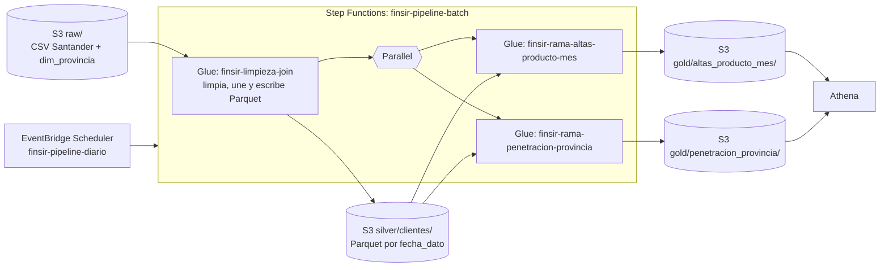

# Trabajo 2, parte A: pipeline batch con Glue, Step Functions y EventBridge Scheduler

Esta guía reúne la creación manual desde la consola de AWS y el despliegue automatizado con Terraform. Ambos caminos implementan el pipeline de la parte A.

## Contenido

- [Resumen](#resumen)
- [Preparación](#preparación)
- [Despliegue automatizado con Terraform](#despliegue-automatizado-con-terraform)
- [Cómo correr el flujo con Terraform](#cómo-correr-el-flujo-con-terraform)
- [Eliminar](#eliminar)
- [Problemas frecuentes](#problemas-frecuentes)
- [Declaración de uso de IA](#declaración-de-uso-de-ia)

---

## Resumen

La parte A construye un pipeline batch sobre los datos de [Santander Product Recommendation](https://www.kaggle.com/c/santander-product-recommendation), del proyecto integrador FINSIR (sistema de recomendación de productos financieros). El README incluye el procedimiento manual desde la consola de AWS y el despliegue automatizado con Terraform.


| Pieza | Qué hace |
| --- | --- |
| EventBridge Scheduler | Un horario inicia la máquina de estados |
| `finsir-limpieza-join` | Lee el CSV de S3, lo limpia, lo une con `dim_provincia.csv` (comunidad, población y renta del INE) por `cod_prov` y escribe Parquet particionado por `fecha_dato` |
| `finsir-rama-altas-producto-mes` | **Pregunta 1:** ¿cuántas contrataciones nuevas tiene cada producto en cada mes, y cuáles son los que más se contratan? |
| `finsir-rama-penetracion-provincia` | **Pregunta 2:** ¿en qué provincias tiene el banco menos clientes en relación con su población, y cuántos clientes le faltan para llegar a la penetración típica? Es la lista de provincias donde priorizar campañas y presencia comercial |
| Athena | Consulta las dos agrupaciones y responde las dos preguntas |

**Datos de partida**

| Conjunto | Archivo | Registros | Columna en común |
| --- | --- | --- | --- |
| Clientes y productos de Santander, 17 cortes mensuales (enero 2015 a mayo 2016) | `train_ver2.csv`, 2.3 GB, 48 columnas | **13 647 309** | `cod_prov` |
| Provincias de España: comunidad autónoma, población (padrón 2016) y renta (2015), del INE | [dim_provincia.csv](data/dim_provincia.csv), 6 columnas | 52 | `cod_prov` |

El primer conjunto supera el mínimo de 5 000 000 de registros, así que no hace falta aumentarlo. El segundo conjunto son datos oficiales del Instituto Nacional de Estadística (INE), reutilizables citando la fuente, descargados de su API (`servicios.ine.es/wstempus`):

- **Población:** tabla 2852, *Población por provincias y sexo* (padrón al 1 de enero de 2016). Las 52 provincias suman 46 557 008, igual que el total nacional del INE.
- **Renta:** tabla 53689, *Atlas de distribución de renta de los hogares, indicadores de renta media y mediana* (2015): renta bruta media por hogar y renta neta media por persona. El INE no publica la renta de 2015 de Álava, Gipuzkoa y Navarra (régimen foral), así que esas tres quedan vacías.
- **Comunidad autónoma:** la que corresponde a cada código de provincia.

El CSV de Santander no se redistribuye en el repositorio: las reglas de la competencia de Kaggle no lo permiten.

**Decisiones del pipeline**

- **Limpieza.** Se descartan 27 734 filas sin `fecha_alta`: no traen edad, sexo ni país, solo los productos. Cuando el segmento o la provincia vienen vacíos en un mes, se toman del mismo cliente en otro mes (recupera 127 974 segmentos y 686 provincias). Se corrigen 22 edades imposibles (126, 127, 163 y 164 años; las de 100 a 117 son clientes reales y se conservan) con la mediana de su segmento, y 2 766 641 rentas vacías con la mediana de su provincia y segmento; el vacío de la renta es permanente por cliente, así que no hay otro mes de donde tomarla. Lo que sigue vacío pasa a `DESCONOCIDO` en los textos, y los `NA` de nómina y pensión a 0. Se quitan cuatro columnas: `ult_fec_cli_1t` y `conyuemp` (casi 100 % vacías), `tipodom` (siempre 1) y `nomprov` (la reemplaza la provincia de la dimensión). Se elimina un registro repetido por `fecha_dato` y `ncodpers`; el archivo trae 0.
- **Join.** Left join con `dim_provincia` por `cod_prov`, para no perder los 65 171 clientes que nunca traen provincia: quedan con comunidad `DESCONOCIDA` y sin población. Cada cliente recibe así la población y la renta de su provincia, que también sirven como variables socioeconómicas para el modelo del proyecto.
- **Partición.** El Parquet se particiona por `fecha_dato`, el mes del corte. Son 17 particiones de 620 000 a 930 000 filas, un tamaño razonable por carpeta. Las dos tareas más frecuentes del proyecto leen un mes: la validación entrena con los cortes hasta abril de 2016 y evalúa con mayo, y los rezagos comparan cada mes con el anterior. Particionar por `ncodpers` (950 000 valores) o por `cod_prov` (52 valores, y Madrid tiene un tercio de las filas) daría carpetas diminutas o desiguales.

---

## Preparación

### Requisitos

- Una cuenta de AWS y la región **N. Virginia (`us-east-1`)**. Todo el trabajo se hace en esa región; verifícala en la esquina superior derecha de cada consola.
- El archivo `train_ver2.csv` descomprimido (descargado de Kaggle) y este repositorio en tu computador.
- La consola de **CloudFormation** sin ningún stack en la región. Ábrela en <https://console.aws.amazon.com/cloudformation/> y, si quedan stacks de los laboratorios, elimínalos antes de empezar. Nada de lo que sigue crea stacks.
- Un navegador con la cuenta ya abierta. No necesitas instalar nada más: el único comando opcional es `aws s3 cp` del paso 1.

Si una consola dice que el servicio no está disponible en el plan gratuito, cambia el plan como explica el [laboratorio 5](../labs/05-firehose/README.md#prerequisites): los créditos que te quedan se conservan.

**Costo.** Glue cobra por DPU-hora (US$ 0.44 en `us-east-1`), con un mínimo de un minuto por ejecución. Con 5 DPU en el trabajo inicial y 4 en cada rama, una ejecución completa cuesta del orden de un dólar (estimado, no medido). S3, Step Functions, EventBridge Scheduler y Athena cuestan centavos con estos volúmenes. No dejes horarios recurrentes activos.

Esta guía sigue el formato y los servicios de los laboratorios [9](../labs/09-glue-batch/README.md) (Glue, Step Functions y EventBridge Scheduler) y [9b](../labs/09b-s3-glue-athena/README.md) (S3, Glue y Athena), con los datos de Santander en vez de los vuelos, y el PySpark del [laboratorio 6b](../labs/06b-spark/README.md). Los laboratorios usan Serverless Framework; aquí cada recurso se crea a mano. Cada paso dice qué esperar. Los valores esperados salen de calcular lo mismo con pandas sobre el CSV completo, y los scripts de Glue se probaron con Spark local sobre una muestra de 271 237 filas.

### Paso 1: El bucket y los datos de partida

1. Abre la consola de **S3** y elige **Create bucket**. Tipo **General purpose**, nombre `finsir-trabajo2-<ID_CUENTA>` (el ID de tu cuenta, 12 dígitos, está en el menú de la esquina superior derecha; el nombre del bucket es único en todo AWS). Deja **Block all public access** marcado y el cifrado por defecto, y elige **Create bucket**.
2. Abre el bucket y, con **Create folder**, crea `raw` y dentro de ella `santander` y `dim_provincia`.
3. En `raw/santander/` elige **Upload**, **Add files**, escoge `train_ver2.csv` y **Upload**. Son 2.1 GiB: deja la pestaña abierta hasta que termine, puede tardar según tu conexión. Esa carpeta debe tener **solo** ese archivo, porque el trabajo de Glue lee la carpeta completa.
4. En `raw/dim_provincia/` sube [data/dim_provincia.csv](data/dim_provincia.csv).

Esperado: `raw/santander/train_ver2.csv` de 2 292 759 599 bytes (2.1 GiB) y `raw/dim_provincia/dim_provincia.csv` de 2324 bytes.

Si prefieres la línea de comandos (necesita el AWS CLI con credenciales), el archivo grande sube más rápido y en partes:

```bash
aws s3 cp train_ver2.csv s3://finsir-trabajo2-<ID_CUENTA>/raw/santander/train_ver2.csv
```

Esto solo mueve datos, no crea recursos.

### Paso 2: El rol de Glue

1. Abre la consola de **IAM**, **Roles**, **Create role**. En **Trusted entity type** elige **AWS service**; en **Use case**, abre la lista **Use cases for other AWS services**, elige **Glue** y **Next**.
2. Marca la política administrada **AWSGlueServiceRole** y **Next**.
3. Nombre del rol: `finsir-glue-role`. **Create role**.
4. Abre el rol, **Add permissions**, **Create inline policy**, pestaña **JSON**. Pega [iam/glue-bucket-policy.json](iam/glue-bucket-policy.json) y reemplaza `YOUR_BUCKET` (dos lugares) por el nombre de tu bucket. **Next**, nombre `finsir-acceso-al-bucket`, **Create policy**.

Esperado: el rol tiene dos políticas, `AWSGlueServiceRole` y `finsir-acceso-al-bucket`.

### Paso 3: El trabajo de Glue inicial

1. Abre la consola de **AWS Glue**, **ETL jobs**, **Create job**, **Script editor**. Motor **Spark**, opción **Upload script**, elige [glue/01_limpieza_join.py](glue/01_limpieza_join.py) y **Create script**.
2. Arriba, cambia el nombre `Untitled job` por `finsir-limpieza-join`.
3. En la pestaña **Job details**:

   | Campo | Valor |
   | --- | --- |
   | IAM Role | `finsir-glue-role` |
   | Type | Spark |
   | Glue version | Glue 6.0 |
   | Language | Python 3 |
   | Worker type | G 1X |
   | Requested number of workers | 5 |
   | Job bookmark | Disable |
   | Number of retries | 0 |
   | Job timeout (minutes) | 60 |

   Abre **Advanced properties** y, al final, en **Job parameters** elige **Add new parameter**: clave `--BUCKET`, valor el nombre de tu bucket.
4. **Save** y luego **Run**.
5. En la pestaña **Runs**, espera hasta que el estado sea **Succeeded**. Tarda entre 5 y 15 minutos (estimado). Mientras corre, el estado pasa por **Starting** y **Running**.
6. En la fila de la ejecución, abre **Output logs** (CloudWatch). Busca el flujo cuyo nombre es el ID de la ejecución (`jr_...`).

Esperado en el log, en las líneas que empiezan por `[finsir]`:

```text
[finsir] filas leidas:                    13647309
[finsir] descartadas (sin fecha_alta):    27734
[finsir] descartadas (duplicadas):        0
[finsir] edades corregidas (fuera 0-122): 22
[finsir] rentas imputadas:                2766641
[finsir] filas escritas en s3://.../silver/clientes/: 13619575
```

Esperado en S3: la carpeta `silver/clientes/` con 17 carpetas, `fecha_dato=2015-01-28/` hasta `fecha_dato=2016-05-28/`, cada una con un archivo `.snappy.parquet`.

### Paso 4: Los trabajos de las dos ramas

Repite el procedimiento del paso 3 dos veces más, con **Create job**, **Script editor**, **Upload script**:

| Nombre del trabajo | Script | Workers |
| --- | --- | --- |
| `finsir-rama-altas-producto-mes` | [02_rama_altas_producto_mes.py](glue/02_rama_altas_producto_mes.py) | 4 |
| `finsir-rama-penetracion-provincia` | [03_rama_penetracion_provincia.py](glue/03_rama_penetracion_provincia.py) | 4 |

Todo lo demás igual que en el paso 3: rol `finsir-glue-role`, Glue 6.0, G 1X, bookmark Disable, 0 reintentos, 60 minutos y el parámetro `--BUCKET`. Los nombres deben ser exactamente esos, porque la máquina de estados los usa.

Ejecuta cada uno una vez con **Run**, para comprobar que funcionan antes de unirlos. El de las altas calcula una ventana por cliente sobre 13.6 millones de filas; tarda unos minutos.

Esperado en cada log: `[finsir] filas escritas en s3://.../gold/altas_producto_mes/: 408` (17 meses por 24 productos) y `[finsir] corte 2016-05-28: 53 filas en s3://.../gold/penetracion_provincia/` (52 provincias y una fila para los clientes sin provincia). En S3 aparecen `gold/altas_producto_mes/` y `gold/penetracion_provincia/`, cada una con un archivo `.parquet`.

### Paso 5: La máquina de estados

1. Abre la consola de **Step Functions**, **State machines**, **Create state machine**. Elige la plantilla **Blank** y **Select**.
2. En Workflow Studio abre la pestaña **Code**, borra el contenido y pega [stepfunctions/state_machine.asl.json](stepfunctions/state_machine.asl.json). Cambia a **Design** para ver el diagrama: `LimpiezaJoin` y, después, `RamasEnParalelo` con las dos ramas lado a lado. Elige **Next**.
3. Nombre `finsir-pipeline-batch`, tipo **Standard**. En **Permissions** deja **Create new role**, y **Create state machine**. Step Functions crea el rol con los permisos para iniciar y esperar los tres trabajos de Glue. Como en el laboratorio 9, cada tarea tiene un tiempo máximo (`TimeoutSeconds`) y un reintento si el trabajo falla (`Retry`); si el reintento también falla, el `Catch` lleva la ejecución al estado `PipelineFallido`.
4. Prueba la máquina antes de programarla: **Start execution**, deja la entrada `{}` y **Start execution**. En el diagrama de la ejecución, `LimpiezaJoin` se pone verde, y solo después se inician a la vez `RamaAltasProductoMes` y `RamaPenetracionProvincia`.

Esperado: la ejecución termina en **Succeeded** en unos 15 a 30 minutos (estimado). Si falla con `AccessDeniedException` de Glue, mira [Problemas frecuentes](#problemas-frecuentes).

No ejecutes a la vez dos pipelines ni lances un trabajo de Glue a mano mientras la máquina corre: cada trabajo admite una sola ejecución concurrente.

### Paso 6: El horario de EventBridge Scheduler

El horario es recurrente, como uno de verdad (todos los días a la misma hora), pero con fecha de fin, para que se dispare una sola vez y no gaste créditos todos los días.

1. Abre la consola de **Amazon EventBridge**, **Scheduler**, **Schedules**, **Create schedule**.
2. En **Schedule detail**:
   - Nombre `finsir-pipeline-diario`.
   - **Occurrence**: **Recurring schedule**. **Time zone**: la tuya, por ejemplo `America/Bogota`. **Schedule type**: **Cron-based schedule**.
   - Elige una hora de **unos 10 minutos en el futuro**. Ejemplo para las 15:30: minutos `30`, horas `15`, día del mes `*`, mes `*`, día de la semana `?`, año `*`. Queda `cron(30 15 * * ? *)`.
   - **Flexible time window**: **Off**.
   - **Timeframe**: activa **End date and time** y pon una hora **1 hora después** de la del disparo (en la misma fecha). Así no se dispara una segunda vez.
   - **Next**.
3. En **Select target** elige **Templated targets**, **AWS Step Functions StartExecution**, y en **State machine** `finsir-pipeline-batch`. En **Input** escribe:

   ```json
   {"origen": "EventBridge Scheduler", "horario": "finsir-pipeline-diario"}
   ```

   Esa entrada queda registrada en la ejecución y es la prueba de que la inició el horario. **Next**.
4. En **Settings**: **Schedule state** **Enable**, **Action after schedule completion** `NONE`, **Retry policy** desactivada. En **Permissions** elige **Create new role for this schedule**. **Next** y **Create schedule**.
5. Espera a la hora del disparo y abre **Step Functions**, `finsir-pipeline-batch`, pestaña **Executions**. Aparece una ejecución nueva, con un nombre que es un UUID. Ábrela: en **Execution input** debe verse el JSON con `"origen": "EventBridge Scheduler"`.

Esperado: la ejecución está **Running** al minuto del disparo y termina en **Succeeded**. Cuando termine, desactiva el horario (**Disable**) o bórralo, para no pagar ejecuciones futuras.

### Paso 7: Las tablas de Athena

1. Abre la consola de **Athena**, **Query editor**. Antes de la primera consulta, abre **Settings**, **Manage**, y en **Location of query result** escribe `s3://<tu bucket>/athena-results/`. **Save**.
2. Copia [athena/01_tablas.sql](athena/01_tablas.sql) desde Visual Studio Code y pégalo en el editor. Reemplaza `YOUR_BUCKET` en los cinco lugares donde aparece.
3. Ejecuta **una sentencia a la vez** (resáltala y **Run**). Después de la sentencia 1, elige la base de datos `finsir` en el panel de la izquierda.

   | Sentencia | Qué crea |
   | --- | --- |
   | 1 | la base de datos `finsir` |
   | 2 | `bronze_santander`, el CSV tal como llegó, todo en texto |
   | 3 | `bronze_dim_provincia`, el segundo conjunto de datos |
   | 4 | `silver_clientes`, los datos transformados, particionados por `fecha_dato` |
   | 5 | `MSCK REPAIR TABLE`, que registra las 17 particiones |
   | 6 | `gold_altas_producto_mes`, la agrupación de la primera rama |
   | 7 | `gold_penetracion_provincia`, la agrupación de la segunda rama |

Esperado en la sentencia 5: `Partitions not in metastore: silver_clientes:fecha_dato=2015-01-28 ...`, 17 en total.

### Paso 8: Las consultas

Copia [athena/02_consultas.sql](athena/02_consultas.sql) y ejecuta una sentencia a la vez.

**Datos de partida y transformados**

- **Sentencia 1:** Esperado: 13647309 filas y 17 meses. Es el número de registros de partida.
- **Sentencia 2:** filas por mes de la capa silver. Esperado: 618504 en 2015-01-28, 630249 en 2015-06-28, 829817 en 2015-07-28 y 931453 en 2016-05-28. En julio de 2015 el banco empieza a reportar a casi 200 000 clientes más.
- **Sentencia 3:** Esperado: 13619575 filas y 949614 clientes distintos.
- **Sentencia 4:** Esperado: 22 edades corregidas, 2766641 rentas imputadas y 65171 clientes sin provincia.

**Primera rama: ¿cuántas altas tiene cada producto cada mes, y cuáles son los más contratados?**

- **Sentencia 5:** Esperado: 408 filas, 24 productos y 17 meses.
- **Sentencia 6:** los productos con más altas en los 16 meses comparables. Esperado: Débito automático 153023, Pensión 84682, Nómina ingreso 73729, Tarjeta de crédito 69107, Cuenta corriente 68974, Nómina 37082, E-cuenta 26241, Depósitos largo plazo 12658, Impuestos 9219 y Cuenta más particular 6842.
- **Sentencia 7:** los tres productos con más altas de cada mes. Esperado en 2016-05-28: Débito automático 10163, Pensión 5513 y Nómina ingreso 5488. En 2015-07-28: Débito automático 9172, Tarjeta de crédito 4886 y Pensión 4850.

*Respuesta:* las contrataciones nuevas se concentran en el débito automático, la pensión y la nómina, seguidas de la tarjeta de crédito. La cuenta corriente tiene 561 615 clientes en mayo de 2016 pero casi no crece (3 854 altas ese mes contra 5 686 bajas). Son los productos que el modelo base de popularidad recomendaría a todos los clientes, la referencia que debe superar el modelo de LightGBM.

**Segunda rama: ¿en qué provincias tiene el banco menos clientes en relación con su población, y cuántos le faltan?**

La *penetración* es el número de clientes del banco por cada mil habitantes de la provincia. La *brecha* son los clientes que le faltan a una provincia para llegar a la penetración mediana de las 52 (16.0 clientes por mil habitantes). Los clientes del archivo son una muestra del banco, así que la penetración compara provincias entre sí y no es una cuota de mercado.

- **Sentencia 8:** Esperado: 53 filas y 931453 clientes, todos del corte 2016-05-28.
- **Sentencia 9:** las 10 provincias a las que más clientes les faltan. Esperado: Santa Cruz de Tenerife (5119 clientes, 5.10 por mil, brecha 10951), Illes Balears (9145, 8.26, 8574), Alicante (22210, 12.09, 7180), Almería (4317, 6.13, 6954), Gipuzkoa (4887, 6.81, 6601), Jaén (4509, 6.96, 5865), Bizkaia (12528, 10.92, 5837), Girona (6313, 8.38, 5747), Tarragona (7651, 9.66, 5029) y Navarra (6024, 9.40, 4229).
- **Sentencia 10:** Esperado: las de más penetración son Madrid (298871 clientes, 46.21 por mil), Salamanca (33.02) y Valladolid (30.64); las de menos, Santa Cruz de Tenerife (5.10), Ceuta (6.07) y Almería (6.13). Madrid tiene nueve veces la penetración de Tenerife.
- **Sentencia 11:** la misma brecha en provincias con renta neta por persona de 10 000 euros o más. Esperado: Illes Balears (8574), Bizkaia (5837), Girona (5747), Tarragona (5029), Castellón (2102), León (1848), Lleida (1507) y Ceuta (840).
- **Sentencia 12:** la brecha sumada por comunidad autónoma. Esperado: Andalucía (19642), País Vasco (15027), Cataluña (12283), Canarias (12159), Comunidad Valenciana (9282) e Islas Baleares (8574).

*Respuesta:* el banco está muy concentrado en Madrid y muy poco presente, para su población, en Canarias (Tenerife), Baleares, el Mediterráneo (Alicante, Almería, Girona, Tarragona), Jaén y el País Vasco. Si cada una de las 26 provincias por debajo de la mediana llegara a la penetración típica, el banco ganaría unos 86 000 clientes de la muestra; Tenerife, Baleares y Alicante suman casi un tercio de esa brecha. Entre ellas, Baleares, Bizkaia, Girona y Tarragona combinan brecha y renta alta, y son las candidatas para una campaña de captación o una nueva oficina. El número de productos por cliente casi no cambia con la penetración (la correlación es 0.11): Madrid tiene 1.65 productos por cliente y las demás entre 0.96 y 1.38.

**Qué queda vacío después de la limpieza**

La limpieza corrige lo que se puede corregir con una regla defendible y no inventa lo que no se sabe. Quedan `null` solo donde el dato no existe:

- **Sentencia 15:** Esperado: 13619575 filas y `null` únicamente en las cuatro columnas de provincia: `cod_prov` y `poblacion_2016` en 65171 filas (clientes que nunca traen provincia), y `renta_bruta_hogar_2015` y `renta_neta_persona_2015` en 263066 (esas 65171 más 197895 de Álava, Gipuzkoa y Navarra, de las que el INE no publica la renta de 2015). `age`, `renta`, `sexo` y `segmento` no tienen ninguno; el segmento sin recuperar queda como `DESCONOCIDO` en 33660 filas, de clientes que nunca lo traen.
- **Sentencia 16:** Esperado: en la primera agrupación, 24 filas sin altas ni bajas (los 24 productos de enero de 2015, que no tiene mes anterior); en la segunda, 1 fila sin provincia y 4 sin renta.

**Por qué se particiona por `fecha_dato`**

- **Sentencias 13 y 14:** los clientes de marzo de 2016 contados sobre el CSV y sobre la capa silver. Esperado: 925076 en las dos. Compara el **Data scanned** que Athena muestra bajo cada resultado: sobre el CSV lee el archivo entero, unos 2.3 GB; sobre silver, el filtro por la columna de partición hace que lea solo la carpeta `fecha_dato=2016-03-28`, y solo la columna que necesita. Anota los dos números para el video.

---

## Despliegue automatizado con Terraform

Necesitas Terraform 1.5+ y credenciales de AWS en el entorno. El código está en [iac/terraform/](iac/terraform/).

```bash
cd parte_a/iac/terraform
cp terraform.tfvars.example terraform.tfvars   # opcional
terraform init
terraform apply
```

Crea el bucket (con los tres scripts y la dimensión ya subidos), los tres roles, los tres trabajos de Glue, la máquina de estados, el horario (**desactivado**) y la base de datos, el grupo de trabajo y las cinco tablas de Athena. Con Terraform la tabla silver usa partition projection: no necesita `MSCK REPAIR TABLE`.

> **No lo uses en la cuenta de la entrega.** La condición eliminatoria 1 del enunciado exige crear los recursos a mano en la consola. Úsalo en otra cuenta, para la sustentación o el proyecto paralelo.

> Si el `apply` falla porque falta un servicio en el plan de la cuenta, actualiza el plan y vuelve a correr `terraform apply`.

## Cómo correr el flujo con Terraform

1. Sube el CSV (Terraform no lo sube, pesa 2.3 GB; el comando exacto sale en el output `subir_el_csv`):

```bash
aws s3 cp train_ver2.csv s3://finsir-trabajo2-<cuenta>/raw/santander/train_ver2.csv
```

2. Inicia la máquina de estados (output `iniciar_la_maquina_de_estados`) o activa el horario con `schedule_enabled = true`:

```bash
aws stepfunctions start-execution --state-machine-arn <ARN_DE_LA_MAQUINA>
```

3. Espera a que la ejecución termine en **Succeeded** (de 15 a 30 minutos, estimado). No lances un trabajo de Glue a mano mientras corre: cada trabajo admite una sola ejecución a la vez.

4. Consulta en Athena con [athena/02_consultas.sql](athena/02_consultas.sql), una sentencia a la vez. Los valores esperados:

| Sentencia | Esperado |
| --- | --- |
| 1 | 13 647 309 filas y 17 meses en el CSV |
| 3 | 13 619 575 filas y 949 614 clientes distintos en silver |
| 5 | 408 filas (24 productos por 17 meses) en la primera agrupación |
| 6 | Más altas: Débito automático 153 023, Pensión 84 682, Nómina ingreso 73 729, Tarjeta de crédito 69 107, Cuenta corriente 68 974 |
| 8 | 53 filas y 931 453 clientes en la segunda agrupación |
| 9 | Provincias a las que más clientes les faltan: Santa Cruz de Tenerife (10 951), Illes Balears (8 574), Alicante (7 180), Almería (6 954), Gipuzkoa (6 601) |
| 13 y 14 | 925 076 clientes de marzo de 2016, leyendo el CSV entero (13) o una sola partición (14): compara el **Data scanned** |

El orden importa: el trabajo inicial debe terminar antes que las ramas (la máquina ya lo garantiza), y las tablas de Athena se consultan después de que termine la ejecución.

Los scripts se prueban en local, sin AWS, con Spark local:

```bash
pip install pyspark pytest
python -m pytest parte_a/glue
```


---

## Eliminar

Hazlo **solo después** de entregar y sustentar. Para el despliegue manual, borra los recursos en este orden:

1. **EventBridge Scheduler:** el horario `finsir-pipeline-diario`.
2. **Step Functions:** la máquina `finsir-pipeline-batch`.
3. **Glue:** los tres trabajos `finsir-*`.
4. **Athena:** ejecuta `DROP TABLE` para las cinco tablas y `DROP DATABASE finsir`. Las tablas son externas: no borran datos.
5. **S3:** vacía y elimina el bucket `finsir-trabajo2-<ID_CUENTA>` y el bucket `aws-glue-assets-<ID_CUENTA>-us-east-1` que creó Glue Studio.
6. **IAM:** los roles `finsir-glue-role` y los roles que crearon Step Functions y EventBridge Scheduler (`StepFunctions-finsir-pipeline-batch-role-...` y `Amazon_EventBridge_Scheduler_SFN_...`).
7. **CloudWatch Logs:** los grupos `/aws-glue/jobs/output` y `/aws-glue/jobs/error`.


## Eliminación de recursos con Terraform

Hazlo solo después de entregar y sustentar.

**Con Terraform**, el bucket se vacía solo (`force_destroy_bucket`):

```bash
cd parte_a/iac/terraform
terraform destroy
```

> El nombre exacto del bucket sale del output `bucket` (`terraform output bucket`).

---

## Problemas frecuentes

| Síntoma | Causa y solución |
| --- | --- |
| El trabajo de Glue falla con `Access Denied` al leer o escribir en S3 | El rol no tiene la política `finsir-acceso-al-bucket`, o `YOUR_BUCKET` quedó sin reemplazar. Revisa el paso 2 |
| `Path does not exist: s3://.../raw/santander/` | El parámetro `--BUCKET` está vacío o mal escrito, o el CSV no está en `raw/santander/` |
| El trabajo inicial termina en `OutOfMemoryError` o en `Container killed` | Sube los workers a 10 en **Job details**, o el tipo a G 2X |
| `ResourceNumberLimitExceeded` al iniciar el trabajo | La cuenta nueva tiene un límite bajo de DPU. Baja los workers a 2 o 3, o pide aumentar la cuota **Max concurrent DPUs** en Service Quotas |
| `Glue.ConcurrentRunsExceededException` en la máquina de estados | Otra ejecución del mismo trabajo sigue en curso. Espera a que termine |
| `AccessDeniedException ... glue:StartJobRun` en la máquina de estados | Al rol de Step Functions le faltan permisos. En IAM, abre el rol de la máquina, **Add permissions**, **Create inline policy**, **JSON** y pega [iam/stepfunctions-glue-policy.json](iam/stepfunctions-glue-policy.json) con tu ID de cuenta |
| El horario no inicia nada | Revisa la zona horaria y que la hora esté en el futuro. En **Scheduler** abre el horario y mira que el estado sea **Enabled** y la fecha de fin sea posterior |
| Athena: `No output location provided` | Falta el paso 1 del paso 7 (carpeta de resultados) |
| Athena: `silver_clientes` devuelve 0 filas | No ejecutaste `MSCK REPAIR TABLE`, o el trabajo inicial no terminó |
| Athena: `HIVE_BAD_DATA ... Parquet` o error de tipos | El esquema de la tabla no coincide con el Parquet. Borra la tabla y créala otra vez con el SQL del repositorio |


