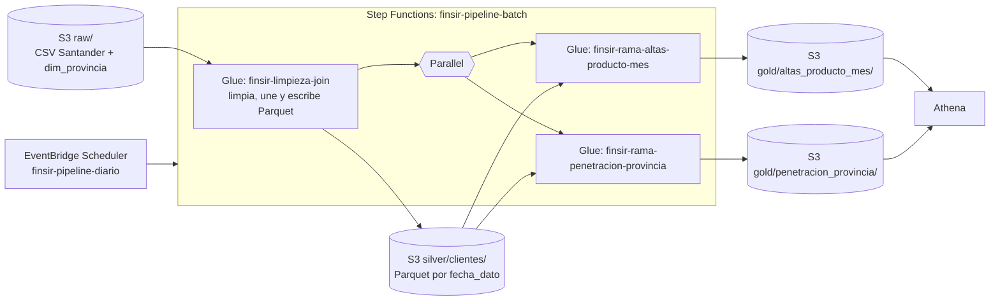

# Trabajo 2, parte A: pipeline batch con Glue, Step Functions y EventBridge Scheduler

Esta guía arma un pipeline de datos batch en AWS. Puedes hacerlo de dos formas: a mano desde la consola de AWS, o automático con Terraform. Las dos construyen lo mismo.

## Contenido

- [Qué construye este pipeline](#qué-construye-este-pipeline)
- [Los datos](#los-datos)
- [Qué hace el pipeline con los datos](#qué-hace-el-pipeline-con-los-datos)
- [Antes de empezar](#antes-de-empezar)
- [Opción 1: a mano desde la consola](#opción-1-a-mano-desde-la-consola)
- [Opción 2: automático con Terraform](#opción-2-automático-con-terraform)
- [Consultar los resultados en Athena](#consultar-los-resultados-en-athena)
- [Borrar todo al terminar](#borrar-todo-al-terminar)
- [Problemas frecuentes](#problemas-frecuentes)

---

## Qué construye este pipeline

El pipeline procesa los datos de [Santander Product Recommendation](https://www.kaggle.com/c/santander-product-recommendation) (del proyecto FINSIR, un recomendador de productos financieros) y responde dos preguntas de negocio.



Cada pieza cumple un rol:

| Pieza                               | Qué hace                                                                                                                               |
| ----------------------------------- | -------------------------------------------------------------------------------------------------------------------------------------- |
| EventBridge Scheduler               | Un horario arranca el pipeline, como lo haría un proceso diario real                                                                   |
| `finsir-limpieza-join`              | Lee el CSV crudo, lo limpia, lo une con las provincias y guarda el resultado en Parquet                                                |
| `finsir-rama-altas-producto-mes`    | **Pregunta 1:** ¿cuántas contrataciones nuevas tiene cada producto cada mes y cuáles se contratan más?                                 |
| `finsir-rama-penetracion-provincia` | **Pregunta 2:** ¿en qué provincias el banco tiene pocos clientes para su población, y cuántos le faltan? Sirve para priorizar campañas |
| Athena                              | Consulta los resultados y responde las dos preguntas                                                                                   |

Las tres capas de datos siguen el patrón clásico: **raw** (datos crudos), **silver** (datos limpios) y **gold** (resultados listos para consultar).

---

## Los datos

| Conjunto                                                                        | Archivo                                                 | Registros      | Columna en común |
| ------------------------------------------------------------------------------- | ------------------------------------------------------- | -------------- | ---------------- |
| Clientes y productos de Santander, 17 cortes mensuales (enero 2015 a mayo 2016) | `train_ver2.csv`, 2.3 GB, 48 columnas                   | **13 647 309** | `cod_prov`       |
| Provincias de España: comunidad, población (2016) y renta (2015), del INE       | [dim_provincia.csv](data/dim_provincia.csv), 6 columnas | 52             | `cod_prov`       |

El primer conjunto tiene 13.6 millones de registros, por encima del mínimo de 5 millones. El segundo son datos oficiales del Instituto Nacional de Estadística (INE), que se pueden reutilizar citando la fuente. Se descargaron de su API (`servicios.ine.es/wstempus`):

- **Población:** tabla 2852, padrón al 1 de enero de 2016. Las 52 provincias suman 46 557 008, igual que el total nacional.
- **Renta:** tabla 53689, Atlas de renta de los hogares (2015). El INE no publica la renta de 2015 de Álava, Gipuzkoa y Navarra (régimen foral), así que esas tres quedan vacías.
- **Comunidad autónoma:** la que corresponde a cada provincia.

El CSV de Santander **no está en el repositorio**: las reglas de Kaggle no permiten redistribuirlo. Descárgalo tú de [Kaggle: Santander Product Recommendation](https://www.kaggle.com/competitions/santander-product-recommendation/data?select=train_ver2.csv.zip), descomprímelo y déjalo en `data/train_ver2.csv`.

---

## Qué hace el pipeline con los datos

Tres decisiones de diseño que vale la pena conocer:

**Limpieza.** El trabajo inicial corrige los datos con reglas defendibles, sin inventar valores:

- Descarta 27 734 filas sin `fecha_alta` (solo traen productos, ni edad ni sexo).
- Cuando el segmento o la provincia vienen vacíos en un mes, los toma del mismo cliente en otro mes.
- Corrige 22 edades imposibles (126, 127, 163 y 164 años) con la mediana de su segmento. Las de 100 a 117 son clientes reales y se conservan.
- Imputa 2 766 641 rentas vacías con la mediana de su provincia y segmento.
- Lo que sigue vacío queda como `DESCONOCIDO` en los textos y `0` en nómina y pensión.
- Quita cuatro columnas inútiles: `ult_fec_cli_1t`, `conyuemp` (casi todo vacío), `tipodom` (siempre 1) y `nomprov` (la reemplaza la provincia de la dimensión).

**Join.** Un _left join_ con `dim_provincia` por `cod_prov`. Se usa left join para no perder los 65 171 clientes que nunca traen provincia (quedan con comunidad `DESCONOCIDA`). Cada cliente recibe la población y la renta de su provincia.

**Partición.** El Parquet se particiona por `fecha_dato` (el mes del corte): 17 particiones de 620 000 a 930 000 filas cada una. Así, cuando una consulta filtra por mes, Athena lee solo esa carpeta en vez del archivo entero.

---

## Antes de empezar

- Una cuenta de AWS, región **N. Virginia (`us-east-1`)**. Trabaja siempre en esa región (revísala arriba a la derecha).
- El archivo `train_ver2.csv` descargado de Kaggle y descomprimido en `data/`.
- El AWS CLI configurado con tus credenciales (solo para subir el CSV).
- La consola de **CloudFormation** sin stacks en la región (borra los de laboratorios anteriores si quedan). Nada de esta guía crea stacks.

**Costo.** Una ejecución completa del pipeline cuesta del orden de un dólar (Glue cobra por DPU-hora). S3, Step Functions, Scheduler y Athena cuestan centavos. No dejes horarios recurrentes activos.

---

## Opción 1: a mano desde la consola

Sigue el formato de los laboratorios [9](https://github.com/si7006eafit/si7006-262/tree/main/labs/09-glue-batch) y [9b](https://github.com/si7006eafit/si7006-262/tree/main/labs/09b-s3-glue-athena), con los datos de Santander.

### Paso 1: El bucket y los datos crudos

1. En **S3**, **Create bucket**. Tipo **General purpose**, nombre `finsir-trabajo2-<ID_CUENTA>` (tu ID de cuenta son 12 dígitos, está arriba a la derecha). Deja **Block all public access** y el cifrado por defecto. **Create bucket**.
2. Dentro del bucket crea la carpeta `raw`, y dentro de ella `santander` y `dim_provincia`.
3. Sube `train_ver2.csv` a `raw/santander/`. Son 2.1 GiB: tarda según tu conexión. Esa carpeta debe tener **solo** ese archivo, porque Glue lee la carpeta completa.
4. Sube [data/dim_provincia.csv](data/dim_provincia.csv) a `raw/dim_provincia/`.

Más rápido por línea de comandos, parado en `parte_a/`:

```bash
aws s3 cp data/train_ver2.csv s3://finsir-trabajo2-<ID_CUENTA>/raw/santander/train_ver2.csv
```

Esperado: `raw/santander/train_ver2.csv` de 2 292 759 599 bytes y `raw/dim_provincia/dim_provincia.csv` de 2324 bytes.

### Paso 2: El rol de Glue

1. En **IAM**, **Roles**, **Create role**. **Trusted entity type**: **AWS service**. En **Use case** elige **Glue**. **Next**.
2. Marca la política **AWSGlueServiceRole**. **Next**.
3. Nombre: `finsir-glue-role`. **Create role**.
4. Abre el rol, **Add permissions**, **Create inline policy**, pestaña **JSON**. Pega [iam/glue-bucket-policy.json](iam/glue-bucket-policy.json) y reemplaza `YOUR_BUCKET` (dos veces) por tu bucket. Nombre `finsir-acceso-al-bucket`, **Create policy**.

Esperado: el rol tiene dos políticas, `AWSGlueServiceRole` y `finsir-acceso-al-bucket`.

### Paso 3: El trabajo de Glue inicial

1. En **AWS Glue**, **ETL jobs**, **Create job**, **Script editor**. Motor **Spark**, **Upload script**, elige [glue/01_limpieza_join.py](glue/01_limpieza_join.py). **Create script**.
2. Cambia el nombre `Untitled job` por `finsir-limpieza-join`.
3. En **Job details**:

    | Campo                       | Valor              |
    | --------------------------- | ------------------ |
    | IAM Role                    | `finsir-glue-role` |
    | Glue version                | Glue 6.0           |
    | Worker type                 | G 1X               |
    | Requested number of workers | 5                  |
    | Job bookmark                | Disable            |
    | Number of retries           | 0                  |
    | Job timeout (minutes)       | 60                 |

    En **Advanced properties** → **Job parameters**, **Add new parameter**: clave `--BUCKET`, valor tu bucket.

4. **Save** y **Run**.
5. En **Runs**, espera a **Succeeded** (5 a 15 minutos). Abre **Output logs** (CloudWatch) para ver el detalle.

Esperado en el log (líneas `[finsir]`):

```text
[finsir] filas leidas:                    13647309
[finsir] descartadas (sin fecha_alta):    27734
[finsir] edades corregidas (fuera 0-122): 22
[finsir] rentas imputadas:                2766641
[finsir] filas escritas en s3://.../silver/clientes/: 13619575
```

Esperado en S3: `silver/clientes/` con 17 carpetas, de `fecha_dato=2015-01-28/` a `fecha_dato=2016-05-28/`.

### Paso 4: Los trabajos de las dos ramas

Repite el paso 3 dos veces más (**Create job**, **Script editor**, **Upload script**):

| Nombre del trabajo                  | Script                                                                         | Workers |
| ----------------------------------- | ------------------------------------------------------------------------------ | ------- |
| `finsir-rama-altas-producto-mes`    | [glue/02_rama_altas_producto_mes.py](glue/02_rama_altas_producto_mes.py)       | 4       |
| `finsir-rama-penetracion-provincia` | [glue/03_rama_penetracion_provincia.py](glue/03_rama_penetracion_provincia.py) | 4       |

Todo lo demás igual que el paso 3. Los nombres deben ser exactos, porque la máquina de estados los busca por nombre. Ejecuta cada uno con **Run** para comprobar que funcionan.

Esperado: `[finsir] filas escritas en .../gold/altas_producto_mes/: 408` (17 meses × 24 productos) y `[finsir] corte 2016-05-28: 53 filas en .../gold/penetracion_provincia/`.

### Paso 5: La máquina de estados

1. En **Step Functions**, **Create state machine**, plantilla **Blank**.
2. En la pestaña **Code**, borra todo y pega [stepfunctions/state_machine.asl.json](stepfunctions/state_machine.asl.json). En **Design** verás `LimpiezaJoin` seguido de las dos ramas en paralelo. **Next**.
3. Nombre `finsir-pipeline-batch`, tipo **Standard**. En **Permissions** deja **Create new role**. **Create state machine**.
4. Pruébala: **Start execution**, entrada `{}`, **Start execution**. `LimpiezaJoin` se pone verde primero, y solo después arrancan las dos ramas a la vez.

Esperado: termina en **Succeeded** en 15 a 30 minutos. No corras dos pipelines a la vez ni lances un trabajo de Glue a mano mientras corre (cada trabajo admite una sola ejecución).

### Paso 6: El horario de EventBridge Scheduler

El horario es recurrente (como uno real), pero con fecha de fin para que se dispare una sola vez y no gaste créditos a diario.

1. En **Amazon EventBridge**, **Scheduler**, **Schedules**, **Create schedule**.
2. **Schedule detail**:
    - Nombre `finsir-pipeline-diario`.
    - **Recurring schedule**, zona horaria la tuya (ej. `America/Bogota`), **Cron-based schedule**.
    - Una hora **unos 10 minutos en el futuro**. Ejemplo 15:30: `cron(30 15 * * ? *)`.
    - **Flexible time window**: **Off**.
    - **End date and time**: activa y pon **1 hora después** del disparo (misma fecha).
3. **Select target**: **Templated targets**, **AWS Step Functions StartExecution**, máquina `finsir-pipeline-batch`. En **Input**:

    ```json
    { "origen": "EventBridge Scheduler", "horario": "finsir-pipeline-diario" }
    ```

4. **Settings**: **Enable**, **Create new role for this schedule**. **Create schedule**.
5. A la hora del disparo, en **Step Functions** → `finsir-pipeline-batch` → **Executions** aparece una ejecución nueva con ese JSON de entrada.

Cuando termine, **desactiva** o borra el horario para no pagar ejecuciones futuras.

---

## Opción 2: automático con Terraform

Terraform crea todo de una vez: el bucket (con los scripts y la dimensión ya subidos), los roles, los tres trabajos de Glue, la máquina de estados, el horario (**desactivado**) y las tablas de Athena. Con Terraform la tabla silver usa _partition projection_, así que no necesitas `MSCK REPAIR TABLE`.

Necesitas **Terraform 1.5+** y credenciales de AWS en el entorno. El código está en [terraform/](terraform/).

```bash
cd terraform
cp terraform.tfvars.example terraform.tfvars   # opcional, para ajustar región u horario
terraform init
terraform apply
```

> Si el `apply` falla porque falta un servicio en el plan de la cuenta, actualiza el plan y vuelve a correr `terraform apply`.

Después del `apply`, sube el CSV (Terraform no lo sube, pesa 2.3 GB) e inicia el pipeline. Parado en `parte_a/`:

```bash
# Sube el CSV (el comando exacto con tu bucket sale en el output subir_el_csv)
aws s3 cp data/train_ver2.csv s3://finsir-trabajo2-<ID_CUENTA>/raw/santander/train_ver2.csv

# Inicia el pipeline (el ARN exacto sale en el output iniciar_la_maquina_de_estados)
aws stepfunctions start-execution --state-machine-arn <ARN_DE_LA_MAQUINA>
```

O activa el horario con `schedule_enabled = true` en `terraform.tfvars`.

Variables que puedes ajustar (en `terraform.tfvars`):

| Variable                             | Default     | Para qué                                                |
| ------------------------------------ | ----------- | ------------------------------------------------------- |
| `region`                             | `us-east-1` | región                                                  |
| `project`                            | `finsir`    | prefijo de los nombres                                  |
| `bucket_name`                        | `""`        | si lo dejas vacío usa `finsir-trabajo2-<cuenta>`        |
| `workers_limpieza` / `workers_ramas` | 5 / 4       | baja estos si da `ResourceNumberLimitExceeded`          |
| `schedule_enabled`                   | `false`     | ponlo en `true` para que el horario dispare el pipeline |

---

## Consultar los resultados en Athena

1. En **Athena**, **Query editor**, **Settings** → **Manage**, pon **Location of query result** en `s3://<tu bucket>/athena-results/`. **Save**. (Con Terraform esto ya queda listo.)
2. Si lo hiciste a mano: copia [athena/01_tablas.sql](athena/01_tablas.sql), reemplaza `YOUR_BUCKET` y ejecuta **una sentencia a la vez**. La sentencia 5 (`MSCK REPAIR TABLE`) registra las 17 particiones. Con Terraform las tablas ya existen, salta este punto.
3. Copia [athena/02_consultas.sql](athena/02_consultas.sql) y ejecuta una sentencia a la vez.

Valores esperados de las consultas principales:

| Sentencia | Esperado                                                                                                                                           |
| --------- | -------------------------------------------------------------------------------------------------------------------------------------------------- |
| 1         | 13 647 309 filas y 17 meses en el CSV                                                                                                              |
| 3         | 13 619 575 filas y 949 614 clientes distintos en silver                                                                                            |
| 5         | 408 filas (24 productos × 17 meses) en la primera agrupación                                                                                       |
| 6         | Más altas: Débito automático 153 023, Pensión 84 682, Nómina ingreso 73 729, Tarjeta de crédito 69 107, Cuenta corriente 68 974                    |
| 8         | 53 filas y 931 453 clientes en la segunda agrupación                                                                                               |
| 9         | Provincias con más clientes faltantes: Santa Cruz de Tenerife (10 951), Illes Balears (8 574), Alicante (7 180), Almería (6 954), Gipuzkoa (6 601) |
| 13 y 14   | 925 076 clientes de marzo de 2016, leyendo el CSV entero (13) o una sola partición (14): compara el **Data scanned**                               |

**Respuesta a la pregunta 1.** Las contrataciones nuevas se concentran en el débito automático, la pensión y la nómina, seguidos de la tarjeta de crédito. Son los productos que un recomendador por popularidad sugeriría a todos, la referencia que debe superar el modelo del proyecto.

**Respuesta a la pregunta 2.** El banco está muy concentrado en Madrid (46 clientes por mil habitantes) y poco presente, para su población, en Canarias, Baleares, el Mediterráneo (Alicante, Almería, Girona, Tarragona), Jaén y el País Vasco. Baleares, Bizkaia, Girona y Tarragona combinan brecha alta y renta alta: son las candidatas para una campaña de captación.

### Probar los scripts en local

Los scripts de Glue se pueden probar sin AWS, con Spark local:

```bash
pip install pyspark pytest
python -m pytest glue
```

---

## Borrar todo al terminar

Hazlo **solo después** de entregar y sustentar.

**Con Terraform** (el bucket se vacía solo por `force_destroy_bucket`):

```bash
cd terraform
terraform destroy
```

> El nombre exacto del bucket sale de `terraform output bucket`.

**A mano**, en este orden:

1. **EventBridge Scheduler:** el horario `finsir-pipeline-diario`.
2. **Step Functions:** la máquina `finsir-pipeline-batch`.
3. **Glue:** los tres trabajos `finsir-*`.
4. **Athena:** `DROP TABLE` de las cinco tablas y `DROP DATABASE finsir`. Las tablas son externas: no borran datos.
5. **S3:** vacía y borra `finsir-trabajo2-<ID_CUENTA>` y el bucket `aws-glue-assets-<ID_CUENTA>-us-east-1` que creó Glue Studio.
6. **IAM:** los roles `finsir-glue-role` y los que crearon Step Functions y EventBridge Scheduler.
7. **CloudWatch Logs:** los grupos `/aws-glue/jobs/output` y `/aws-glue/jobs/error`.

---

## Problemas frecuentes

| Síntoma                                                               | Causa y solución                                                                                                                               |
| --------------------------------------------------------------------- | ---------------------------------------------------------------------------------------------------------------------------------------------- |
| Glue falla con `Access Denied` en S3                                  | Al rol le falta la política `finsir-acceso-al-bucket`, o `YOUR_BUCKET` quedó sin reemplazar. Revisa el paso 2                                  |
| `Path does not exist: s3://.../raw/santander/`                        | El parámetro `--BUCKET` está vacío o mal escrito, o el CSV no está en `raw/santander/`                                                         |
| Glue termina en `OutOfMemoryError` o `Container killed`               | Sube los workers a 10, o el tipo a G 2X                                                                                                        |
| `ResourceNumberLimitExceeded` al iniciar el trabajo                   | La cuenta tiene un límite bajo de DPU. Baja los workers a 2 o 3, o pide aumentar **Max concurrent DPUs** en Service Quotas                     |
| `Glue.ConcurrentRunsExceededException`                                | Otra ejecución del mismo trabajo sigue en curso. Espera a que termine                                                                          |
| `AccessDeniedException ... glue:StartJobRun` en la máquina de estados | Al rol de Step Functions le faltan permisos. Pega [iam/stepfunctions-glue-policy.json](iam/stepfunctions-glue-policy.json) con tu ID de cuenta |
| El horario no inicia nada                                             | Revisa la zona horaria, que la hora esté en el futuro y que el estado sea **Enabled**                                                          |
| Athena: `No output location provided`                                 | Falta configurar la carpeta de resultados (primer punto de la sección de Athena)                                                               |
| Athena: `silver_clientes` devuelve 0 filas                            | No corriste `MSCK REPAIR TABLE`, o el trabajo inicial no terminó                                                                               |
| Athena: `HIVE_BAD_DATA ... Parquet`                                   | El esquema de la tabla no coincide con el Parquet. Borra la tabla y créala de nuevo                                                            |
