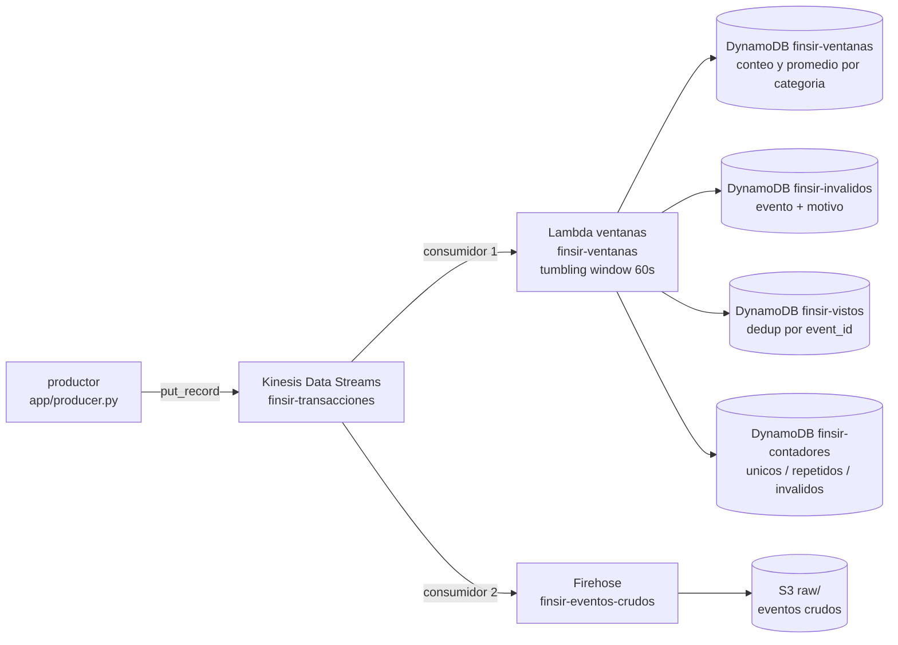

# Trabajo 2, parte B: streaming con Kinesis, Lambda, DynamoDB y S3 (IaC con Terraform)

Flujo de streaming del proyecto FINSIR, desplegado con Terraform. Sirve para **levantar la parte B rápido en la sustentación**: para la entrega los recursos se crean a mano en la consola, y esta IaC los reproduce idénticos en otra cuenta para la sustentación.

---

## 1. Qué hace, en una frase

Un productor publica movimientos financieros (cada uno con una **categoría** y un **monto**) a un stream de Kinesis. Dos consumidores leen ese stream: una **Lambda** cuenta y promedia por categoría cada minuto y lo guarda en DynamoDB, y un **Firehose** guarda todos los eventos crudos en S3.



## 2. El evento

```json
{ "event_id": "uuid", "client_id": 123, "category": "nomina", "amount": 1234.56, "ts": "2026-11-06T15:30:00Z" }
```

- **`category`**: el tipo de producto (`nomina`, `tarjeta_credito`, `cuenta_corriente`, `pension`, `deposito`, `hipoteca`). Es la _categoría_ del enunciado.
- **`amount`**: el monto del movimiento. Es el _campo numérico_ del que se saca el promedio.
- **`event_id`**: identifica el evento. Dos eventos con el mismo `event_id` son repetidos.
- Un evento es **inválido** si le falta la categoría, el monto no es numérico, o el monto queda fuera de `[0, 50000]`.

## 3. Qué guarda cada cosa

| Recurso                              | Qué guarda / hace                                                                            |
| ------------------------------------ | -------------------------------------------------------------------------------------------- |
| **Kinesis `finsir-transacciones`**   | El stream: el tubo ordenado por donde pasan todos los eventos                                |
| **Lambda `finsir-ventanas`**         | La aplicación de ventanas. Cada minuto cuenta los eventos y promedia el monto, por categoría |
| **DynamoDB `finsir-ventanas`**       | Un ítem por (minuto, categoría) con `event_count`, `avg_amount` y `sum_amount`               |
| **DynamoDB `finsir-vistos`**         | Los `event_id` ya procesados, para no contar un repetido dos veces                           |
| **DynamoDB `finsir-invalidos`**      | Cada evento inválido con el campo `reason` (el motivo del descarte)                          |
| **DynamoDB `finsir-contadores`**     | Tres contadores: `unique_processed`, `duplicates_discarded`, `invalid_discarded`             |
| **Firehose `finsir-eventos-crudos`** | El segundo consumidor: vuelca el stream a S3 sin tocar los eventos                           |
| **S3 `finsir-parte-b-<cuenta>`**     | Los eventos crudos, en `raw/dt=YYYY-MM-DD/`, comprimidos en GZIP                             |

## 4. Cómo cada punto del enunciado queda cubierto

| Punto (sección 4 del PDF)                                                                | Dónde                                                                                  |
| ---------------------------------------------------------------------------------------- | -------------------------------------------------------------------------------------- |
| 1. Productor continuo ≥ 5 min, con repetidos e inválidos a propósito                     | [app/producer.py](app/producer.py)                                                     |
| 2. Ventanas de 1 min: conteo y promedio por categoría; repetidos no se cuentan dos veces | Lambda `finsir-ventanas` + tabla `finsir-vistos`                                       |
| 3. Inválidos apartados con su motivo                                                     | tabla `finsir-invalidos` (campo `reason`)                                              |
| 4. Resultado de cada ventana en DynamoDB + consulta que responde una pregunta            | tabla `finsir-ventanas` + [app/query_results.py](app/query_results.py)                 |
| 5. Segundo consumidor que guarda los crudos en S3                                        | Firehose `finsir-eventos-crudos` → bucket S3                                           |
| 6. Conteos que cuadran                                                                   | tabla `finsir-contadores` + `producer_summary.json`, comparados por `query_results.py` |

**Por qué Lambda (y no Flink).** El enunciado sugiere Flink pero permite Lambda. Elegimos Lambda por **conocimiento previo del servicio y facilidad de implementación para el equipo**.

## 5. Creación manual desde la consola de AWS

Esta parte se hace en la consola gráfica. La idea es crear primero las piezas que Lambda necesita y, al final, conectar los consumidores al stream. Haz todo en una misma región; los nombres de abajo corresponden al prefijo `finsir` y a `us-east-1`.

### 5.1 Crea las tablas de DynamoDB

En DynamoDB, elige **Create table**. Para cada tabla deja la capacidad en **On-demand** (también puede aparecer como **Pay-per-request**). No necesitas índices secundarios.

| Nombre de la tabla | Partition key | Sort key | Para qué la usa el código |
|---|---|---|---|
| `finsir-ventanas` | `window_start` (String) | `category` (String) | Guarda conteo, promedio y suma por ventana y categoría |
| `finsir-vistos` | `event_id` (String) | — | Recuerda qué IDs válidos ya se contaron |
| `finsir-invalidos` | `event_id` (String) | — | Guarda los inválidos junto con el motivo |
| `finsir-contadores` | `counter` (String) | — | Acumula únicos, repetidos e inválidos |

La clave debe llamarse exactamente así y ser tipo String; Lambda usa esos nombres al escribir. En `finsir-vistos` y `finsir-invalidos`, abre la configuración de la tabla y activa **Time to Live (TTL)** con el atributo `expires_at`. Esto permite que DynamoDB elimine los registros antiguos después del periodo definido por el código. Espera a que las cuatro tablas estén `Active`.

### 5.2 Crea el bucket S3

En S3, crea un bucket en la misma región. Los nombres de bucket son globales, así que `finsir-parte-b-<id-de-cuenta>` puede estar ocupado; si pasa eso, agrega un sufijo y anota el nombre, porque Firehose tendrá que apuntar a ese mismo bucket.

Deja habilitado **Block all public access** y el cifrado predeterminado con claves administradas por S3 (SSE-S3). No hace falta crear la carpeta `raw`: Firehose la crea al escribir el primer objeto.

### 5.3 Crea el stream de Kinesis

En **Kinesis Data Streams**, elige **Create data stream**. Llámalo `finsir-transacciones`, selecciona capacidad **Provisioned** y configura **1 shard**. Si la consola permite ajustar la retención en esta pantalla, usa **24 horas**. Crea el stream y espera a que el estado cambie a `Active`.

El productor enviará los registros a este stream; Lambda y Firehose lo leerán como dos consumidores independientes.

### 5.4 Crea el rol que usará la función Lambda

El rol de ejecución es la identidad que Lambda usa mientras corre el código. No es tu usuario de la consola: tu usuario también debe tener permiso para crear la función y asignarle un rol.

En **IAM → Roles → Create role**:

1. En **Trusted entity type**, selecciona **AWS service**.
2. En **Use case**, selecciona **Lambda** y continúa. IAM configura así la relación de confianza para que `lambda.amazonaws.com` pueda asumir el rol.
3. Puedes adjuntar `AWSLambdaBasicExecutionRole` para que la función escriba logs en CloudWatch Logs. Esta política administrada es cómoda para el laboratorio, aunque sus permisos de logs son más amplios que un único grupo.
4. Nombra el rol, por ejemplo `finsir-lambda-ventanas-role`, y créalo.
5. Abre el rol que acabas de crear. En **Add permissions → Create inline policy**, selecciona la pestaña **JSON** y agrega permisos para Kinesis y las cuatro tablas.

Antes de guardar la política, reemplaza `ID_DE_CUENTA` por el número de cuenta de AWS y cambia `us-east-1` si elegiste otra región:

```json
{
  "Version": "2012-10-17",
  "Statement": [
    {
      "Sid": "ReadFinsirStream",
      "Effect": "Allow",
      "Action": [
        "kinesis:GetRecords",
        "kinesis:GetShardIterator",
        "kinesis:DescribeStream",
        "kinesis:DescribeStreamSummary",
        "kinesis:ListShards"
      ],
      "Resource": "arn:aws:kinesis:us-east-1:ID_DE_CUENTA:stream/finsir-transacciones"
    },
    {
      "Sid": "ListStreamsForConsole",
      "Effect": "Allow",
      "Action": "kinesis:ListStreams",
      "Resource": "*"
    },
    {
      "Sid": "AccessFinsirTables",
      "Effect": "Allow",
      "Action": [
        "dynamodb:PutItem",
        "dynamodb:UpdateItem",
        "dynamodb:GetItem"
      ],
      "Resource": [
        "arn:aws:dynamodb:us-east-1:ID_DE_CUENTA:table/finsir-ventanas",
        "arn:aws:dynamodb:us-east-1:ID_DE_CUENTA:table/finsir-vistos",
        "arn:aws:dynamodb:us-east-1:ID_DE_CUENTA:table/finsir-invalidos",
        "arn:aws:dynamodb:us-east-1:ID_DE_CUENTA:table/finsir-contadores"
      ]
    }
  ]
}
```

Ponle un nombre a la política, por ejemplo `finsir-lambda-stream-tables`, y guárdala. `ListStreams` aparece con `Resource: "*"` porque esa acción lista los streams de la cuenta y no se restringe a un ARN particular. Las otras acciones de lectura están limitadas al stream del proyecto; los permisos DynamoDB, a las cuatro tablas.

Si decidiste **no** adjuntar `AWSLambdaBasicExecutionRole` y quieres restringir también los logs, crea en CloudWatch Logs el grupo `/aws/lambda/finsir-ventanas` y agrega a la política acciones `logs:CreateLogStream` y `logs:PutLogEvents`, limitadas al ARN de ese grupo. Si sí adjuntaste la política básica, no necesitas duplicar esos permisos en la inline.

Cuando agregues el trigger de Kinesis más adelante, si no aparece `finsir-transacciones` en el selector, revisa los permisos de la identidad con la que iniciaste sesión. `kinesis:ListStreams` en el rol de ejecución da permisos a la función; no sustituye los permisos de tu usuario para configurar el trigger. Tu usuario también debe poder pasarle el rol a Lambda (`iam:PassRole`).

### 5.5 Empaqueta el código y crea la Lambda

La función que procesa cada ventana está en `app/windowing/handler.py`. Lambda recibirá un ZIP y buscará un módulo llamado `handler`; por eso `handler.py` tiene que estar directamente en la raíz del ZIP, no dentro de `app/windowing/`.

Abre PowerShell en la carpeta principal del repositorio, donde está `parte_b`. Este bloque crea el ZIP en `parte_b\finsir-windowing.zip`, así después lo encuentras fácilmente en el selector de archivos de la consola:

```powershell
$zipPath = Join-Path (Get-Location) "parte_b\finsir-windowing.zip"
Push-Location .\parte_b\app\windowing
try {
    Compress-Archive -LiteralPath .\handler.py -DestinationPath $zipPath -Force
}
finally {
    Pop-Location
}
```

`Push-Location` entra en la carpeta que contiene `handler.py`. `Compress-Archive` incluye ese archivo en el ZIP y `Pop-Location` te devuelve a la carpeta del proyecto, incluso si el empaquetado muestra un error. Comprueba el contenido del ZIP con:

```powershell
python -c "import zipfile; print(zipfile.ZipFile(r'parte_b\finsir-windowing.zip').namelist())"
```

El resultado esperado es `['handler.py']`. Si aparece una ruta como `app/windowing/handler.py`, no subas ese ZIP: Lambda no encontrará el módulo usando el handler `handler.handler`. Ahora abre **Lambda → Functions → Create function** y:

1. Selecciona **Author from scratch**.
2. En **Function name**, escribe `finsir-ventanas`.
3. Elige runtime **Python 3.12**.
4. En permisos, selecciona **Use an existing role** y elige `finsir-lambda-ventanas-role`.
5. Crea la función.
6. En la sección del código, usa **Upload from → .zip file**. En el selector de archivos, busca la carpeta del proyecto y selecciona `parte_b\finsir-windowing.zip`. Guarda o despliega el cambio si la consola lo solicita.

Luego abre **Configuration → General configuration → Edit**. Configura el handler como `handler.handler`, el timeout en **60 segundos** y la memoria en **256 MB**. El primer `handler` es el nombre del archivo `handler.py`; el segundo es la función Python que se ejecuta dentro de ese archivo.

En **Configuration → Environment variables → Edit**, agrega estas claves y valores. La función las usa para saber dónde guardar cada tipo de dato:

| Key | Value |
|---|---|
| `RESULTS_TABLE` | `finsir-ventanas` |
| `DEDUP_TABLE` | `finsir-vistos` |
| `REJECTS_TABLE` | `finsir-invalidos` |
| `COUNTERS_TABLE` | `finsir-contadores` |
| `AMOUNT_MIN` | `0` |
| `AMOUNT_MAX` | `50000` |

Guarda las variables. Si algún nombre de tabla está distinto en DynamoDB, corrige aquí el valor para que coincida exactamente.

### 5.6 Conecta Kinesis a Lambda

En la página de la función `finsir-ventanas`, selecciona **Add trigger** y elige **Kinesis**. Selecciona el stream `finsir-transacciones` y configura el inicio como `LATEST`. Esto significa que el mapeo leerá los registros nuevos que lleguen después de activarlo; por eso se crea antes de arrancar el productor.

En las opciones avanzadas configura batch size `200`, ventana de agregación (**Tumbling window**) `60` segundos, reintentos máximos `2` y **Bisect batch on function error** habilitado si la consola lo ofrece. No confundas el tumbling window de 60 segundos con el maximum batching window: son ajustes distintos. La ventana de 60 segundos es la que agrupa el cálculo por minuto.

Guarda el trigger y espera a que quede habilitado. Si el trigger no puede leer el stream, revisa que el rol tenga `GetRecords`, `GetShardIterator`, `DescribeStream`, `DescribeStreamSummary` y `ListShards` sobre el ARN correcto.

### 5.7 Crea Firehose para guardar los eventos crudos

En **Amazon Data Firehose**, crea un delivery stream con nombre `finsir-eventos-crudos`:

1. Elige como origen **Amazon Kinesis Data Streams** y selecciona `finsir-transacciones`.
2. Elige destino **Amazon S3** y selecciona el bucket del paso 5.2.
3. Configura el prefijo de salida como `raw/dt=!{timestamp:yyyy-MM-dd}/` y el prefijo de errores como `errors/!{firehose:error-output-type}/dt=!{timestamp:yyyy-MM-dd}/`.
4. Configura el buffer en 60 segundos o 1 MiB y la compresión en GZIP.
5. No habilites transformación ni conversión de formato: Firehose debe conservar el contenido de los eventos.
6. Habilita logs de entrega en CloudWatch.
7. Si Firehose ofrece crear el rol de servicio, permite que lo cree. Si seleccionas un rol existente, debe poder leer el stream y escribir objetos en el bucket.
8. Crea el delivery stream y espera a que esté `Active`.

Firehose escribe los archivos en S3 después de acumular datos según el buffer. No te preocupes si el objeto no aparece inmediatamente; espera al menos el intervalo configurado después del último evento.

### 5.8 Comprueba el despliegue manual

Antes de publicar, vuelve a revisar que Kinesis, las tablas y Firehose estén activos, que el trigger de Lambda esté habilitado con tumbling window de 60 segundos y que la función tenga el rol, las variables y el handler correctos. Cuando todo esté listo, sigue los comandos de **Cómo correr el flujo**. Los pasos de publicación y consulta son iguales para el despliegue manual y el de Terraform.

## 6. Despliegue automatizado con Terraform

Necesitas Terraform 1.5+, Python 3 con `boto3` y credenciales de AWS en el entorno.

```bash
cd parte_b/terraform
cp terraform.tfvars.example terraform.tfvars   # opcional
terraform init
terraform apply
```

> Si el `apply` falla con `SubscriptionRequiredException`, la cuenta no tiene Kinesis habilitado en su plan. Actívalo y vuelve a correr `terraform apply`.

## 7. Cómo correr el flujo

Desde `parte_b/` (los scripts usan rutas `app/...`):

```bash
pip install -r app/requirements.txt
```

1. Publica eventos durante 5 minutos (comando exacto en el output correr_el_productor)

```bash
python app/producer.py --stream finsir-transacciones --minutes 5 --region us-east-1
```
2. Espera 1-2 min a que cierre la última ventana y Firehose vacíe su buffer

3. Consulta DynamoDB y verifica que los conteos cuadran
```bash
python app/query_results.py --prefix finsir --region us-east-1
```

El orden importa: arranca el productor **después** del `apply` (el stream se lee desde `LATEST`, solo ve lo que llega estando conectado).

El productor guarda `producer_summary.json` con `published`, `duplicates_sent` e `invalid_sent`. `query_results.py` lo compara con los contadores de DynamoDB y comprueba:

```
published == unique_processed + duplicates_discarded + invalid_discarded
```

## 8. Cómo eliminar todo

El bucket de S3 debe quedar **vacío** antes del `destroy`, así que vacíalo primero y después destruye:

1. Vacía el bucket de eventos crudos (reemplaza <cuenta> por tu id de cuenta)
```bash
aws s3 rm s3://finsir-parte-b-<cuenta>/ --recursive --region us-east-1
```
2. Destruye el resto de la infraestructura
```
cd parte_b/terraform
terraform destroy
```

> El nombre exacto del bucket sale del output `bucket` (`terraform output bucket`).
