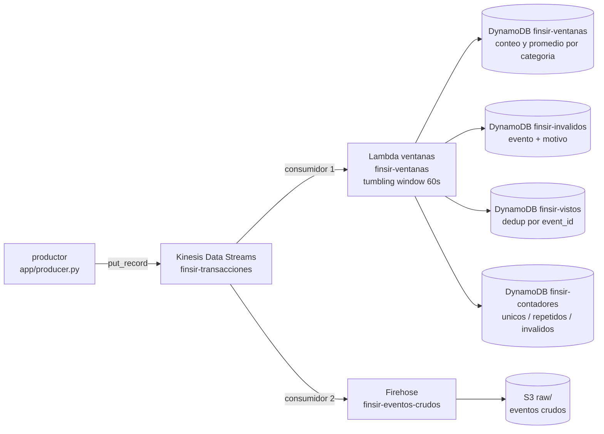

# Trabajo 2, parte B: streaming con Kinesis, Lambda, DynamoDB y S3 (IaC con Terraform)

Flujo de streaming del proyecto FINSIR, desplegado con Terraform. Sirve para **levantar la parte B rápido en la sustentación**: para la entrega los recursos se crean a mano en la consola, y esta IaC los reproduce idénticos en otra cuenta para la sustentación.

---

## 1. Qué hace, en una frase

Un productor publica movimientos financieros (cada uno con una **categoría** y un **monto**) a un stream de Kinesis. Dos consumidores leen ese stream: una **Lambda** cuenta y promedia por categoría cada minuto y lo guarda en DynamoDB, y un **Firehose** guarda todos los eventos crudos en S3.



## 2. El evento

```json
{ "event_id": "uuid", "client_id": 123, "category": "nomina", "amount": 1234.56, "ts": "2026-11-06T15:30:00Z" }
```

- **`category`**: el tipo de producto (`nomina`, `tarjeta_credito`, `cuenta_corriente`, `pension`, `deposito`, `hipoteca`). Es la _categoría_ del enunciado.
- **`amount`**: el monto del movimiento. Es el _campo numérico_ del que se saca el promedio.
- **`event_id`**: identifica el evento. Dos eventos con el mismo `event_id` son repetidos.
- Un evento es **inválido** si le falta la categoría, el monto no es numérico, o el monto queda fuera de `[0, 50000]`.

## 3. Qué guarda cada cosa

| Recurso                              | Qué guarda / hace                                                                            |
| ------------------------------------ | -------------------------------------------------------------------------------------------- |
| **Kinesis `finsir-transacciones`**   | El stream: el tubo ordenado por donde pasan todos los eventos                                |
| **Lambda `finsir-ventanas`**         | La aplicación de ventanas. Cada minuto cuenta los eventos y promedia el monto, por categoría |
| **DynamoDB `finsir-ventanas`**       | Un ítem por (minuto, categoría) con `event_count`, `avg_amount` y `sum_amount`               |
| **DynamoDB `finsir-vistos`**         | Los `event_id` ya procesados, para no contar un repetido dos veces                           |
| **DynamoDB `finsir-invalidos`**      | Cada evento inválido con el campo `reason` (el motivo del descarte)                          |
| **DynamoDB `finsir-contadores`**     | Tres contadores: `unique_processed`, `duplicates_discarded`, `invalid_discarded`             |
| **Firehose `finsir-eventos-crudos`** | El segundo consumidor: vuelca el stream a S3 sin tocar los eventos                           |
| **S3 `finsir-parte-b-<cuenta>`**     | Los eventos crudos, en `raw/dt=YYYY-MM-DD/`, comprimidos en GZIP                             |

## 4. Cómo cada punto del enunciado queda cubierto

| Punto (sección 4 del PDF)                                                                | Dónde                                                                                  |
| ---------------------------------------------------------------------------------------- | -------------------------------------------------------------------------------------- |
| 1. Productor continuo ≥ 5 min, con repetidos e inválidos a propósito                     | [app/producer.py](app/producer.py)                                                     |
| 2. Ventanas de 1 min: conteo y promedio por categoría; repetidos no se cuentan dos veces | Lambda `finsir-ventanas` + tabla `finsir-vistos`                                       |
| 3. Inválidos apartados con su motivo                                                     | tabla `finsir-invalidos` (campo `reason`)                                              |
| 4. Resultado de cada ventana en DynamoDB + consulta que responde una pregunta            | tabla `finsir-ventanas` + [app/query_results.py](app/query_results.py)                 |
| 5. Segundo consumidor que guarda los crudos en S3                                        | Firehose `finsir-eventos-crudos` → bucket S3                                           |
| 6. Conteos que cuadran                                                                   | tabla `finsir-contadores` + `producer_summary.json`, comparados por `query_results.py` |

**Por qué Lambda (y no Flink).** El enunciado sugiere Flink pero permite Lambda. Elegimos Lambda por **conocimiento previo del servicio y facilidad de implementación para el equipo**.

## 5. Cómo desplegarlo

Necesitas Terraform 1.5+, Python 3 con `boto3` y credenciales de AWS en el entorno.

```bash
cd parte_b/terraform
cp terraform.tfvars.example terraform.tfvars   # opcional
terraform init
terraform apply
```

> Si el `apply` falla con `SubscriptionRequiredException`, la cuenta no tiene Kinesis habilitado en su plan. Actívalo y vuelve a correr `terraform apply`.

## 6. Cómo correr el flujo

Desde `parte_b/` (los scripts usan rutas `app/...`):

```bash
pip install -r app/requirements.txt
```

1. Publica eventos durante 5 minutos (comando exacto en el output correr_el_productor)

```bash
python app/producer.py --stream finsir-transacciones --minutes 5 --region us-east-1
```
2. Espera 1-2 min a que cierre la última ventana y Firehose vacíe su buffer

3. Consulta DynamoDB y verifica que los conteos cuadran
```bash
python app/query_results.py --prefix finsir --region us-east-1
```

El orden importa: arranca el productor **después** del `apply` (el stream se lee desde `LATEST`, solo ve lo que llega estando conectado).

El productor guarda `producer_summary.json` con `published`, `duplicates_sent` e `invalid_sent`. `query_results.py` lo compara con los contadores de DynamoDB y comprueba:

```
published == unique_processed + duplicates_discarded + invalid_discarded
```

## 7. Cómo eliminar todo

El bucket de S3 debe quedar **vacío** antes del `destroy`, así que vacíalo primero y después destruye:

1. Vacía el bucket de eventos crudos (reemplaza <cuenta> por tu id de cuenta)
```bash
aws s3 rm s3://finsir-parte-b-<cuenta>/ --recursive --region us-east-1
```
2. Destruye el resto de la infraestructura
```
cd parte_b/terraform
terraform destroy
```

> El nombre exacto del bucket sale del output `bucket` (`terraform output bucket`).
