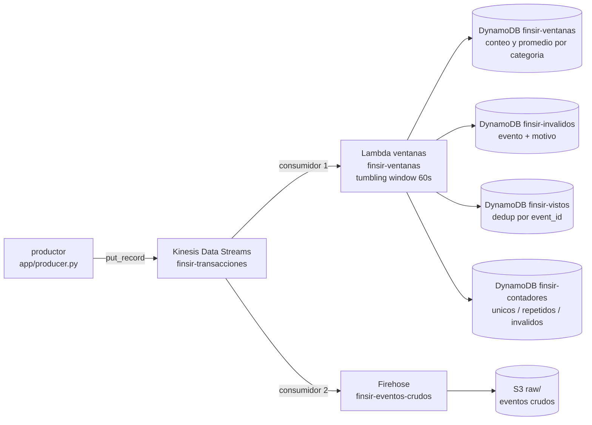

# Trabajo 2, parte B: streaming con Kinesis, Lambda, DynamoDB y S3 (IaC con Terraform)

Este folder despliega con Terraform el flujo de streaming de la parte B del proyecto FINSIR. Sirve para **levantar la parte B rápido en la sustentación**: el compañero crea los recursos a mano en la consola para la entrega, y esta IaC los reproduce idénticos en otra cuenta para la demostración.

> **No uses esto en la cuenta del trabajo 2.** La condición eliminatoria 1 del enunciado exige crear los recursos a mano en la consola, sin infraestructura como código, y lo verifica con la consola de CloudFormation vacía. Úsalo en otra cuenta o para la sustentación, y no lo incluyas en lo que se evalúa como creación manual.

---

## El dominio

Los eventos son **movimientos financieros** de clientes de FINSIR. Cada evento trae una **categoría** (el tipo de producto: `nomina`, `tarjeta_credito`, `cuenta_corriente`, `pension`, `deposito`, `hipoteca`) y un **campo numérico** (`amount`, el monto del movimiento). La aplicación calcula, por ventanas de un minuto y por categoría, el **conteo** de eventos y el **promedio** del monto.

```json
{"event_id": "uuid", "client_id": 123, "category": "nomina", "amount": 1234.56, "ts": "2026-11-06T15:30:00Z"}
```

Un evento es **inválido** si le falta la categoría, el monto no es numérico, o el monto queda fuera del rango `[amount_min, amount_max]` (por defecto `[0, 50000]`). Un evento es **repetido** cuando llega otra vez con el mismo `event_id`.



## Cómo cada requisito del enunciado queda cubierto

| Requisito (sección 4) | Dónde |
| --- | --- |
| 1. Productor continuo ≥ 5 min, con repetidos e inválidos a propósito | [app/producer.py](app/producer.py) |
| 2. Ventanas de 1 min: conteo y promedio por categoría; repetidos no se cuentan dos veces | [app/windowing/handler.py](app/windowing/handler.py), con `tumbling_window_in_seconds = 60` y dedup por `event_id` en la tabla `finsir-vistos` |
| 3. Eventos inválidos apartados con su motivo | tabla `finsir-invalidos` (campo `reason`) |
| 4. Resultado de cada ventana en DynamoDB y consulta que responde una pregunta | tabla `finsir-ventanas`; consulta en [app/query_results.py](app/query_results.py) |
| 5. Segundo consumidor que guarda los eventos crudos en S3 | Firehose `finsir-eventos-crudos` → bucket `finsir-parte-b-<cuenta>` |
| 6. Conteos que cuadran | tabla `finsir-contadores` + `producer_summary.json`, comparados por `query_results.py` |

**Por qué Lambda y no Flink.** El enunciado sugiere Flink pero permite Lambda. Lambda con *tumbling windows* da la ventana de un minuto con estado entre invocaciones, es íntegramente IaC, y cuesta centavos en la demo. La deduplicación se hace con una escritura condicional en `finsir-vistos` (atómica), así un `event_id` repetido se cuenta una sola vez aunque llegue en otra ventana o en otro lote.

## Qué crea

| Archivo | Recursos |
| --- | --- |
| [kinesis.tf](terraform/kinesis.tf) | el stream `finsir-transacciones` |
| [dynamodb.tf](terraform/dynamodb.tf) | las tablas `finsir-ventanas`, `finsir-vistos`, `finsir-invalidos` y `finsir-contadores` (todas on-demand) |
| [lambda.tf](terraform/lambda.tf) | la Lambda `finsir-ventanas` (Python 3.12) y su *event source mapping* con ventana de 60 s |
| [s3_firehose.tf](terraform/s3_firehose.tf) | el bucket `finsir-parte-b-<cuenta>` y el Firehose `finsir-eventos-crudos` que lee el stream y escribe a `raw/` |
| [iam.tf](terraform/iam.tf) | los roles de la Lambda y del Firehose, con el mínimo de permisos |

## Cómo usarlo

Necesitas Terraform 1.5 o más nuevo, Python 3 con `boto3` y las credenciales de AWS en el entorno.

```bash
cd trabajo2/parte_b/terraform
cp terraform.tfvars.example terraform.tfvars   # opcional
terraform init
terraform apply
```

Después, desde `trabajo2/parte_b/`:

```bash
pip install -r app/requirements.txt

# 1. Publica eventos durante 5 minutos (comando exacto en el output correr_el_productor)
python app/producer.py --stream finsir-transacciones --minutes 5 --region us-east-1

# 2. Consulta DynamoDB y verifica que los conteos cuadran
python app/query_results.py --prefix finsir --region us-east-1
```

El productor imprime y guarda `producer_summary.json` con `published`, `duplicates_sent` e `invalid_sent`. `query_results.py` lee los contadores de DynamoDB y comprueba:

```
published == unique_processed + duplicates_discarded + invalid_discarded
```

Los eventos crudos aparecen en `s3://finsir-parte-b-<cuenta>/raw/dt=.../` (Firehose acumula hasta 60 s o 1 MB antes de escribir; para la demo espera ese minuto).

Para eliminar todo (el bucket se vacía solo, por `force_destroy_bucket`):

```bash
terraform destroy
```

## Notas

- **Ventana de un minuto.** `starting_position = "LATEST"`: arranca el productor **después** del `apply`. La primera ventana tras conectar puede quedar parcial; por eso el productor corre 5 minutos y produce varias ventanas completas.
- **Conteos.** Los contadores de `finsir-contadores` son acumulados de la cuenta: si repites la demo sin borrar la tabla, resetéala (`terraform destroy`/`apply` de la tabla, o borra sus ítems) antes de comparar con un `producer_summary.json` nuevo.
- **Dedup entre ejecuciones.** La tabla `finsir-vistos` recuerda los `event_id` ya vistos (con TTL de 2 días). Para una demo limpia parte de tablas vacías.
- **Costo.** 1 shard de Kinesis cuesta ~US$ 0.015/hora; Lambda, DynamoDB on-demand, Firehose y S3 son centavos con estos volúmenes. No dejes el stream encendido.
